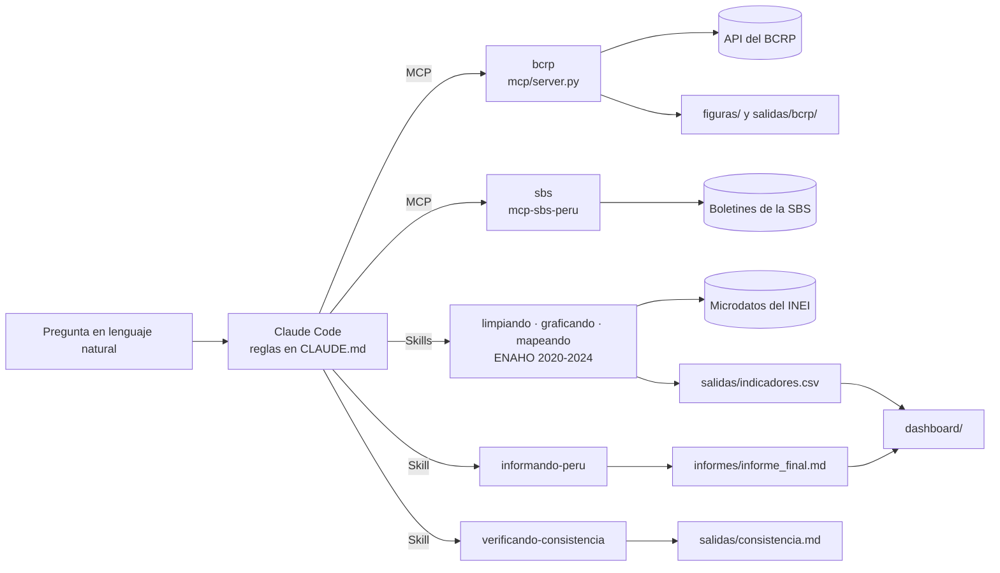

# Agente de investigación socioeconómica del Perú

Tarea 4 del curso Python Intermedio ([enunciado](https://github.com/d2cml-ai/Data-Science-Python/issues/201)). Es un agente en Claude Code que responde preguntas sobre la economía y la pobreza del Perú con datos oficiales: series del BCRP por un servidor MCP propio, boletines de la SBS por un segundo MCP y microdatos de la ENAHO 2020-2024 del INEI por Skills. Cada cifra del informe sale de una herramienta y se puede rastrear hasta su fuente.

**Pregunta de investigación:** ¿Cómo evolucionaron la inflación, la actividad económica, la morosidad bancaria y la pobreza monetaria del Perú entre 2020 y 2024, y qué brechas territoriales y urbano-rurales presentaba la pobreza monetaria en 2024?

| Entregable | Archivo |
|---|---|
| Informe final | [`informes/informe_final.md`](informes/informe_final.md) |
| Servidor MCP del BCRP y sus 10 pruebas | [`mcp/server.py`](mcp/server.py), [`mcp/test_server.py`](mcp/test_server.py) |
| Skills de la ENAHO | [`.claude/skills/`](.claude/skills/) |
| Validación de la ENAHO | [`salidas/validacion.txt`](salidas/validacion.txt) |
| Evaluación con y sin MCP y Skills | [`evaluacion/resultados.csv`](evaluacion/resultados.csv), [`evaluacion/comparacion.md`](evaluacion/comparacion.md) |
| Evidencias del uso de IA | [`evidencias_ia/`](evidencias_ia/) |

## 1. Objetivo

Construir un agente que no conteste de memoria. Ante una pregunta en lenguaje natural, el agente busca la serie o el indicador correcto, lo consulta en la fuente oficial, calcula con código y no a mano, y entrega gráficos, un mapa y un informe con la procedencia de cada número. Después, una evaluación mide si esas herramientas mejoran las respuestas frente a Claude Code sin ellas.

El proyecto separa dos tipos de preguntas:
- **Preguntas de investigación.** Muestran qué se puede aprender del Perú con estas fuentes. El informe responde la de arriba, y el agente puede abordar otras del mismo tipo:
  - qué departamentos superan la pobreza nacional y qué tan grande es la brecha urbano-rural;
  - cómo se movieron juntas la inflación y el tipo de cambio entre 2020 y 2024.
- **Preguntas de evaluación.** Miden cuánto mejoran las respuestas al sumar los MCP, las skills y la verificación automática. Por eso cada una tiene una respuesta verificable fijada antes de correr (sección 9). Se complementan con pedidos ambiguos, imposibles o con premisas dudosas, donde lo correcto es pedir una aclaración, explicitar un supuesto o decir que no hay datos.

## 2. Arquitectura



- **`CLAUDE.md`** fija las reglas del agente: ninguna cifra de memoria, nada de cálculos a mano, informar las fallas, pedir aclaración ante preguntas ambiguas y no confundir asociación con causalidad.
- **`salidas/indicadores.csv`** es la fuente única de las cifras de la ENAHO. La escribe `limpiando-enaho` y la leen los gráficos, el mapa, el informe, el verificador y el dashboard, así que todos muestran el mismo número.
- El informe se arma en dos pasos. Claude redacta un borrador con marcadores en lugar de números (`{{enaho.pobreza_nacional|1}}`, `{{bcrp.resumen(codigo=PN01273PM, desde=2020-01, hasta=2024-12).ultimo.valor|2}}`). Después un script resuelve cada marcador llamando otra vez a las herramientas y rechaza cualquier cifra escrita a mano.

## 3. Herramientas MCP

### Servidor del BCRP (`mcp/server.py`, FastMCP)

| Componente | Qué hace |
|---|---|
| `buscar_series(texto, frecuencia, limite)` | Busca en el catálogo oficial del BCRP por palabras, sin importar tildes ni mayúsculas. |
| `serie(codigo, desde, hasta)` | Devuelve los datos de una serie entre dos fechas (`2025-01`, `2025-01-15` o `2025`, según la frecuencia), con los periodos normalizados (`Ene.2025` → `2025-01`, `T1.25` → `2025-T1`) y sin los `n.d.`. |
| `resumen(codigo, desde, hasta)` | Calcula primero, último, cambio, variación porcentual, promedio, máximo y mínimo, cada uno con su periodo. |
| **`comparar_series(codigo_a, codigo_b, desde, hasta)`** | Herramienta propia. Alinea dos series de la misma frecuencia por periodo y devuelve cuántos periodos comparten, su correlación de Pearson y la diferencia en cada periodo. Si las frecuencias no coinciden, explica el error en vez de mezclar datos mensuales con diarios. |
| `graficar_serie(codigo, desde, hasta, titulo)` | Guarda el gráfico en `figuras/` y sus datos en `salidas/bcrp/`, con unidad, periodo y fuente. |
| Recurso `bcrp://serie/{codigo}` | Ficha descriptiva de la serie: nombre, grupo, frecuencia, fechas disponibles y URL. |
| Prompts `interpretar_indicador` e `informe` | Guías reutilizables que obligan a citar código, periodo y URL en cada cifra. |

El servidor tolera las fallas de la API. Reintenta con espera creciente, valida el contenido y no solo el código HTTP, porque el BCRP responde una página HTML anti-bots con estado 200. Guarda las respuestas en caché por 24 horas y, si la API no responde, usa la copia vieja con un aviso. Cuando no hay datos, devuelve un `ToolError` con el código y el rango pedidos.

### Servidor de la SBS (segunda fuente oficial)

[`mcp-sbs-peru`](https://github.com/rodnm/mcp-sbs-peru) lee los boletines estadísticos de la Superintendencia de Banca, Seguros y AFP: morosidad, ROE y liquidez por entidad (`indicadores`), rankings (`ranking`), cualquier boletín por su código (`reporte`), AFP y seguros. En el informe aporta la morosidad de la banca múltiple a diciembre de cada año de 2020 a 2024 (boletín B-2401) y el contexto financiero de 2024. Se instala desde GitHub con `uvx`, sin copiar su código.

## 4. Skills

Están en `.claude/skills/`. Cada una tiene un `SKILL.md` que Claude Code carga cuando la pregunta lo amerita, y un script que hace el trabajo.

| Skill | Qué hace |
|---|---|
| **`limpiando-enaho`** | Lee los módulos 34 (sumaria) y 02 (miembros) de 2020 a 2024 con las llaves como texto, filtra a los residentes habituales (`((p204==1)&(p205==2))\|((p204==2)&(p206==1))`), une con `merge(..., validate="m:1")` y define `urbano = estrato <= 5` y `pobre = pobreza <= 2`. Pondera por hogar (`factor07 × mieperho`) para las cifras oficiales nacionales, de área y departamentales, y por persona (`facpob07`) para sexo y edad. Valida contra metas oficiales del INEI (Informe Técnico 2025), escribe `salidas/validacion.txt` y genera `salidas/indicadores.csv` con cobertura multianual (columna `anio`). |
| **`graficando-enaho`** | Grafica la pobreza por área, sexo, edad o departamento, y la serie temporal de evolución 2020-2024 (`figuras/pobreza_serie_2020_2024.png`) con títulos informativos, unidad, periodo y fuente. Si falta la base procesada o los indicadores, corre `limpiando-enaho`. |
| **`mapeando-enaho`** | Hace los mapas departamental (25 departamentos) y de ámbitos territoriales (26 ámbitos con Lima desagregada) uniendo `ubigeo[:2]` con `FIRST_IDDP` sobre límites oficiales del IGN. Compara cada departamento con el informe técnico del INEI (Cuadro III.1) en `salidas/mapa_vs_referencia.csv`; Lima (departamento 15) figura como "sin cifra publicada por el INEI", porque el INEI la publica desagregada. |
| `descargando-enaho` | Baja los zip de microdatos del INEI a `datos/`. |
| ★ `informando-peru` | Arma el informe con marcadores, tabla de trazabilidad y referencias (ver la sección 2). |
| ★ `verificando-consistencia` | Contrasta las herramientas entre sí y escribe `salidas/consistencia.md` con OK, DIFERENCIA, FALLA o NO VERIFICABLE. Compara la pobreza con dos ponderadores, el mapa con los indicadores, la inflación a 12 meses recalculada desde el índice del IPC con la publicada, `resumen` con `serie` y cada cifra del informe con su fuente. |

## 5. Fuentes de datos

| Fuente | Enlace | Cómo se obtiene |
|---|---|---|
| ENAHO 2020-2024, módulo 34 (sumaria) | `https://proyectos.inei.gob.pe/iinei/srienaho/descarga/STATA/{código}-Modulo34.zip`, con los códigos 737 (2020), 759 (2021), 784 (2022), 906 (2023) y 966 (2024); por ejemplo, [2024](https://proyectos.inei.gob.pe/iinei/srienaho/descarga/STATA/966-Modulo34.zip) | `descargando-enaho` |
| ENAHO 2020-2024, módulo 02 (miembros del hogar) | `https://proyectos.inei.gob.pe/iinei/srienaho/descarga/STATA/{código}-Modulo02.zip`, con los mismos códigos | `descargando-enaho` |
| Límites oficiales del IGN, publicados en OCHA HDX (COD-AB) | [25 departamentos](referencias/limites_departamentales_ign.geojson) y [26 ámbitos, con Lima desagregada](referencias/limites_ambitos_ign.geojson); procedencia en [`referencias/README.md`](referencias/README.md) | derivados con `scripts/preparar_limites.py` e incluidos en el repositorio |
| Series del BCRP | API: `https://estadisticas.bcrp.gob.pe/estadisticas/series/api/{código}/json/{desde}/{hasta}` ([documentación](https://estadisticas.bcrp.gob.pe/estadisticas/series/documentos/bcrpdataapi.pdf)) | servidor `bcrp`, al consultar |
| Boletines de la SBS | archivos oficiales de la SBS; cada respuesta del servidor trae la URL del boletín ([detalle](https://github.com/rodnm/mcp-sbs-peru)) | servidor `sbs`, al consultar |
| Cifras oficiales de pobreza 2024 (INEI) | [`referencias/inei_pobreza_2024.csv`](referencias/inei_pobreza_2024.csv) | incluida en el repo, extraída de Cuadros III.1 y III.4 del informe técnico del INEI |

Los microdatos no se suben al repositorio: `datos/` está en `.gitignore`.

### Referencias (APA 7.ª edición)

Las genera `informando-peru` a partir de los metadatos de cada fuente consultada (`referencias_apa.py`). Las series del BCRP y los boletines de la SBS cambian con el tiempo, por eso llevan fecha de consulta; las URL exactas de cada consulta están en la tabla de trazabilidad del informe.

- Banco Central de Reserva del Perú. (s. f.-a). *Indicadores de las empresas bancarias - Cartera atrasada neta / Colocaciones netas (%) - Empresas Bancarias* (Serie PN07746EM) [Conjunto de datos]. BCRPData. Recuperado el 7 de noviembre de 2026, de https://estadisticas.bcrp.gob.pe/estadisticas/series/mensuales/resultados/PN07746EM/html
- Banco Central de Reserva del Perú. (s. f.-b). *Índice de precios Lima Metropolitana (var% 12 meses) - IPC* (Serie PN01273PM) [Conjunto de datos]. BCRPData. Recuperado el 7 de noviembre de 2026, de https://estadisticas.bcrp.gob.pe/estadisticas/series/mensuales/resultados/PN01273PM/html
- Banco Central de Reserva del Perú. (s. f.-c). *Producto bruto interno por tipo de gasto (variaciones porcentuales reales) - PBI* (Serie PM04923AA) [Conjunto de datos]. BCRPData. Recuperado el 7 de noviembre de 2026, de https://estadisticas.bcrp.gob.pe/estadisticas/series/anuales/resultados/PM04923AA/html
- Banco Central de Reserva del Perú. (s. f.-d). *Producto bruto interno y demanda interna (variación porcentual interanual) - PBI* (Serie PN01728AM) [Conjunto de datos]. BCRPData. Recuperado el 7 de noviembre de 2026, de https://estadisticas.bcrp.gob.pe/estadisticas/series/mensuales/resultados/PN01728AM/html
- Instituto Geográfico Nacional. (2020). *Peru - Subnational administrative boundaries* (Versión v01) [Conjunto de datos]. OCHA Field Information Services Section; Humanitarian Data Exchange. Recuperado el 5 de noviembre de 2026, de https://data.humdata.org/dataset/cod-ab-per
- Instituto Nacional de Estadística e Informática. (s. f.-a). *Encuesta Nacional de Hogares sobre Condiciones de Vida y Pobreza 2020: Módulo 02, Características de los miembros del hogar* (Código 737) [Conjunto de datos]. Recuperado el 5 de noviembre de 2026, de https://proyectos.inei.gob.pe/iinei/srienaho/descarga/STATA/737-Modulo02.zip
- Instituto Nacional de Estadística e Informática. (s. f.-b). *Encuesta Nacional de Hogares sobre Condiciones de Vida y Pobreza 2020: Módulo 34, Sumarias (variables calculadas)* (Código 737) [Conjunto de datos]. Recuperado el 5 de noviembre de 2026, de https://proyectos.inei.gob.pe/iinei/srienaho/descarga/STATA/737-Modulo34.zip
- Instituto Nacional de Estadística e Informática. (s. f.-c). *Encuesta Nacional de Hogares sobre Condiciones de Vida y Pobreza 2021: Módulo 02, Características de los miembros del hogar* (Código 759) [Conjunto de datos]. Recuperado el 5 de noviembre de 2026, de https://proyectos.inei.gob.pe/iinei/srienaho/descarga/STATA/759-Modulo02.zip
- Instituto Nacional de Estadística e Informática. (s. f.-d). *Encuesta Nacional de Hogares sobre Condiciones de Vida y Pobreza 2021: Módulo 34, Sumarias (variables calculadas)* (Código 759) [Conjunto de datos]. Recuperado el 5 de noviembre de 2026, de https://proyectos.inei.gob.pe/iinei/srienaho/descarga/STATA/759-Modulo34.zip
- Instituto Nacional de Estadística e Informática. (s. f.-e). *Encuesta Nacional de Hogares sobre Condiciones de Vida y Pobreza 2022: Módulo 02, Características de los miembros del hogar* (Código 784) [Conjunto de datos]. Recuperado el 5 de noviembre de 2026, de https://proyectos.inei.gob.pe/iinei/srienaho/descarga/STATA/784-Modulo02.zip
- Instituto Nacional de Estadística e Informática. (s. f.-f). *Encuesta Nacional de Hogares sobre Condiciones de Vida y Pobreza 2022: Módulo 34, Sumarias (variables calculadas)* (Código 784) [Conjunto de datos]. Recuperado el 5 de noviembre de 2026, de https://proyectos.inei.gob.pe/iinei/srienaho/descarga/STATA/784-Modulo34.zip
- Instituto Nacional de Estadística e Informática. (s. f.-g). *Encuesta Nacional de Hogares sobre Condiciones de Vida y Pobreza 2023: Módulo 02, Características de los miembros del hogar* (Código 906) [Conjunto de datos]. Recuperado el 5 de noviembre de 2026, de https://proyectos.inei.gob.pe/iinei/srienaho/descarga/STATA/906-Modulo02.zip
- Instituto Nacional de Estadística e Informática. (s. f.-h). *Encuesta Nacional de Hogares sobre Condiciones de Vida y Pobreza 2023: Módulo 34, Sumarias (variables calculadas)* (Código 906) [Conjunto de datos]. Recuperado el 5 de noviembre de 2026, de https://proyectos.inei.gob.pe/iinei/srienaho/descarga/STATA/906-Modulo34.zip
- Instituto Nacional de Estadística e Informática. (s. f.-i). *Encuesta Nacional de Hogares sobre Condiciones de Vida y Pobreza 2024: Módulo 02, Características de los miembros del hogar* (Código 966) [Conjunto de datos]. Recuperado el 2 de noviembre de 2026, de https://proyectos.inei.gob.pe/iinei/srienaho/descarga/STATA/966-Modulo02.zip
- Instituto Nacional de Estadística e Informática. (s. f.-j). *Encuesta Nacional de Hogares sobre Condiciones de Vida y Pobreza 2024: Módulo 34, Sumarias (variables calculadas)* (Código 966) [Conjunto de datos]. Recuperado el 2 de noviembre de 2026, de https://proyectos.inei.gob.pe/iinei/srienaho/descarga/STATA/966-Modulo34.zip
- Instituto Nacional de Estadística e Informática. (2025). *Perú: Evolución de la pobreza monetaria, 2015-2024: Informe técnico*. https://cdn.www.gob.pe/uploads/document/file/8058556/6763186-peru-evolucion-de-la-pobreza-monetaria-2015-2024.pdf
- Superintendencia de Banca, Seguros y AFP. (s. f.-a). *Indicadores Financieros por Caja Municipal al 31 de diciembre de 2024* (Boletín C-1301) [Conjunto de datos]. Recuperado el 7 de noviembre de 2026, de https://intranet2.sbs.gob.pe/estadistica/financiera/2024/Diciembre/C-1301-di2024.XLS
- Superintendencia de Banca, Seguros y AFP. (s. f.-b). *Indicadores Financieros por Empresa Bancaria al 31 de diciembre de 2020* (Boletín B-2401) [Conjunto de datos]. Recuperado el 7 de noviembre de 2026, de https://intranet2.sbs.gob.pe/estadistica/financiera/2020/Diciembre/B-2401-di2020.XLS
- Superintendencia de Banca, Seguros y AFP. (s. f.-c). *Indicadores Financieros por Empresa Bancaria al 31 de diciembre de 2021* (Boletín B-2401) [Conjunto de datos]. Recuperado el 7 de noviembre de 2026, de https://intranet2.sbs.gob.pe/estadistica/financiera/2021/Diciembre/B-2401-di2021.XLS
- Superintendencia de Banca, Seguros y AFP. (s. f.-d). *Indicadores Financieros por Empresa Bancaria al 31 de diciembre de 2022* (Boletín B-2401) [Conjunto de datos]. Recuperado el 7 de noviembre de 2026, de https://intranet2.sbs.gob.pe/estadistica/financiera/2022/Diciembre/B-2401-di2022.XLS
- Superintendencia de Banca, Seguros y AFP. (s. f.-e). *Indicadores Financieros por Empresa Bancaria al 31 de diciembre de 2023* (Boletín B-2401) [Conjunto de datos]. Recuperado el 7 de noviembre de 2026, de https://intranet2.sbs.gob.pe/estadistica/financiera/2023/Diciembre/B-2401-di2023.XLS
- Superintendencia de Banca, Seguros y AFP. (s. f.-f). *Indicadores Financieros por Empresa Bancaria al 31 de diciembre de 2024* (Boletín B-2401) [Conjunto de datos]. Recuperado el 7 de noviembre de 2026, de https://intranet2.sbs.gob.pe/estadistica/financiera/2024/Diciembre/B-2401-di2024.XLS

## 6. Instalación

Requisitos: [uv](https://docs.astral.sh/uv/), Python 3.12 o superior (uv lo instala si falta) y [Claude Code](https://docs.claude.com/claude-code).

```bash
git clone https://github.com/rodnm/agente-socioeconomico-peru
cd agente-socioeconomico-peru
uv sync
```

## 7. Conectar los MCP a Claude Code

El archivo [`.mcp.json`](.mcp.json) declara los servidores `bcrp` (`uv run mcp/server.py`), `sbs` y `fetch`, y [`.claude/settings.json`](.claude/settings.json) los habilita y permite sus herramientas. Basta con abrir Claude Code en la raíz del repo:

```bash
claude            # la primera vez pide aprobar los servidores del proyecto
/mcp              # dentro de Claude Code: los tres deben figurar como conectados
```

Para registrarlo en otro proyecto: `claude mcp add bcrp -- uv run --directory <ruta al repo> mcp/server.py`.

## 8. Reproducir el procesamiento y las pruebas

```bash
# Datos de la ENAHO y procesamiento (soporta --anio 2020..2024 o --todos)
uv run .claude/skills/descargando-enaho/scripts/descargar.py --todos
uv run .claude/skills/limpiando-enaho/scripts/limpiar.py --todos           # salidas/indicadores.csv (2020-2024) y salidas/validacion.txt
uv run .claude/skills/graficando-enaho/scripts/graficar.py                 # genera cortes transversales y figuras/pobreza_serie_2020_2024.png
uv run .claude/skills/mapeando-enaho/scripts/mapear.py                     # mapas/pobreza_departamento.png y pobreza_ambitos.png

# Pruebas
uv run pytest mcp/test_server.py      # las 8 originales de la sesión 04 y 2 nuevas, contra la API real: 10 passed
uv run pytest tests                   # robustez, skills, informe, consistencia, evaluación y dashboard, sin internet

# Informe, verificación y dashboard
uv run .claude/skills/informando-peru/scripts/armar_informe.py              # informes/borrador.md → informe_final.md
uv run .claude/skills/verificando-consistencia/scripts/verificar.py         # salidas/consistencia.md
uv run streamlit run dashboard/app.py

# Evaluación (cada pregunta es una sesión nueva de claude -p)
uv run evaluacion/verdades.py                                               # respuestas esperadas del BCRP, sin el MCP
uv run evaluacion/evaluar.py --modos A B
uv run evaluacion/evaluar.py --modos memoria solo-mcp solo-skills sin-propia
uv run evaluacion/evaluar.py --robustez --modos A B
```

## 9. Resultados de la evaluación

Son 10 preguntas con respuesta verificable: 4 del BCRP, 4 de la ENAHO y 2 mixtas. Cada una corrió en una sesión nueva de Claude Code (Sonnet), y las respuestas esperadas se fijaron en un commit antes de la primera corrida.

> **Alcance de estos resultados (evaluación v1).** Se midieron sobre el proyecto tal como estaba el 2 de noviembre de 2026, antes de incorporar la ENAHO 2020–2024, la tabla del INEI, los límites del IGN y las referencias APA. Además, el `CLAUDE.md` global y el estilo de salida del usuario se aplicaron en todos los modos (ver la sección 10). Está prevista una evaluación v2, aislada y sobre la versión final, con las mismas preguntas.

| | Sin MCP ni Skills (A) | Con MCP y Skills (B) |
|---|---|---|
| Respuestas correctas | 8 de 10 | **10 de 10** |
| Incorrectas o sin respuesta | 2 (Cusco y Lima Metropolitana) | 0 |
| Tiempo promedio | 38.1 s | 22.2 s |
| Costo total | USD 2.22 | USD 2.30 |

- **Comparación** ([`evaluacion/comparacion.md`](evaluacion/comparacion.md)):
  - Los dos modos aciertan las cifras del BCRP. B las cita siempre con el código de serie y la URL de la API.
  - A falla donde la web no alcanza: tomó una cifra departamental de una fuente secundaria y resolvió de otra manera la definición de Lima Metropolitana.
  - En la revisión manual de las interpretaciones, ninguno de los dos modos fue impecable: B también hizo una afirmación causal sin respaldo en m1.
- **Ablación** ([`evaluacion/ablacion.md`](evaluacion/ablacion.md)):
  - Sin herramientas, el modelo acierta 2 de 10 y responde «no sé» en 6.
  - Con solo el MCP acierta 8, porque repite los errores de la ENAHO del Modo A.
  - Con solo las skills acierta 10, porque llamó a la API del BCRP por su cuenta.
  - La primera versión de la ablación tenía fugas entre componentes, y se documenta cómo se corrigió.
- **Robustez:** son 12 pedidos ambiguos, imposibles o con premisas dudosas, con la conducta esperada fijada antes de correr.
  - El Modo A cumplió la conducta en 11 y el Modo B en 10. Ninguno inventó un dato inexistente.
  - En los pedidos de causalidad y de dos fuentes de morosidad, la revisión manual aprobó a los dos modos.
  - En el de frecuencias incompatibles, B correlacionó promedios mensuales con `comparar_series`. A dio como cifra principal la correlación con los datos diarios y usó el promedio mensual solo como control.

Las tablas completas salen de `uv run evaluacion/analizar.py` → [`evaluacion/metricas.md`](evaluacion/metricas.md). Los datos están en [`resultados.csv`](evaluacion/resultados.csv) y [`robustez_resultados.csv`](evaluacion/robustez_resultados.csv).

## 10. Limitaciones y problemas encontrados

- **Bloqueo anti-bots del BCRP.** La mañana del 2 de noviembre de 2026 la API del BCRP respondió a todo programa, desde la primera consulta, una página de Imperva («Pardon Our Interruption») con estado 200, mientras el navegador sí cargaba. Por eso el servidor valida el contenido de cada respuesta, reintenta, guarda caché y responde con un error explícito. También por eso las pruebas de robustez simulan la API (`tests/test_robustez_mcp.py`). Una lección: el BCRP entrega su JSON con `Content-Type: text/html`, así que comprobar la cabecera no sirve para saber si respondió datos; hay que leer el cuerpo.
- **Ponderadores.** La pobreza nacional se reproduce con 27.58 % al ponderar por hogar (`factor07 × mieperho`) y da 27.53 % con `facpob07`. Las dos están dentro de la tolerancia de 0.1 puntos; el verificador reporta la diferencia.
- **Niveles de agregación.** El BCRP publica series nacionales o de Lima con frecuencia mensual o diaria; la ENAHO da tasas anuales por área y departamento. El informe las presenta juntas como contexto, sin afirmar relaciones causales, y la SBS no publica boletines por departamento.
- **Evaluación v1 sin aislamiento completo.** El Modo A corre en una carpeta temporal con solo los zip crudos y con `--strict-mcp-config`, para que no herede los servidores MCP ni las skills del usuario. Aun así, el `CLAUDE.md` global, las reglas y el estilo de salida del usuario se aplicaron en todos los modos: el Modo A llegó a responder con voseo.
  - `--setting-sources project,local` no excluye ese `CLAUDE.md`. Se comprobó con palabras testigo que solo aparecen en los archivos globales.
  - La variable `CLAUDE_CODE_DISABLE_CLAUDE_MDS=1` sí lo excluye, sin perder la autenticación.
  - Como esa variable apaga también el `CLAUDE.md` del proyecto, los modos que lo usan reciben su contenido con `--append-system-prompt`. `evaluacion/evaluar.py` aplica esta configuración en todos los modos de la evaluación v2.
- **Lima como departamento.** El INEI no publica una cifra de pobreza para el departamento de Lima en conjunto: publica Lima Metropolitana (27.6 %) y Lima provincias (21.7 %). El análisis usa esos dos ámbitos. El agregado del departamento 15 aparece solo donde lo exige la consigna (las 25 unidades del mapa por `ubigeo[:2]`), y no se valida contra el INEI porque no hay cifra oficial con la cual compararlo.
- **Lo que encontró el propio agente.** En la primera corrida integrada, el verificador marcó la inflación como no verificable. El agente investigó y vio que `verificar.py` usaba `PN01270PM`, el índice del IPC base 2009 que el BCRP descontinuó en diciembre de 2021. Se corrigió por `PN38705PM` (Dic.2021 = 100). En la segunda corrida, el agente leyó las instrucciones de las skills de la ENAHO y corrió sus scripts directamente, sin invocarlas. Ahora `informando-peru` exige invocarlas, porque cada skill trae sus propias reglas, como detenerse si una validación falla.
- **Permisos en `claude -p`.** Mientras no se acepte el diálogo de confianza del proyecto en una sesión interactiva, Claude Code ignora los permisos de `.claude/settings.json`. Por eso las corridas automáticas pasan `--allowedTools` explícitamente.

## 11. Ejemplo de una ejecución completa

Una sola ejecución integrada desde la raíz del repositorio. Antes de correrla se retiraron el plan, el borrador, el informe y las salidas de la ENAHO y del BCRP, para que el agente los produjera desde cero. La ejecución se aísla de la configuración del usuario, porque sin eso hereda su `CLAUDE.md` global, su estilo de salida y sus servidores MCP (ver la sección 10):

```bash
CLAUDE_CODE_DISABLE_CLAUDE_MDS=1 claude -p "Investiga esta pregunta y entrégame el informe: ¿Cómo evolucionaron la inflación, la actividad económica, la morosidad bancaria y la pobreza monetaria del Perú entre 2020 y 2024, y qué brechas territoriales y urbano-rurales presentaba la pobreza en 2024? Usa el BCRP para la inflación, la actividad y la morosidad neta, la SBS para la morosidad bancaria 2020-2024 y el contexto financiero, y la ENAHO para la serie de pobreza 2020-2024 y la foto territorial de 2024 con sus mapas. Al final verifica la consistencia de las cifras."   --model sonnet --setting-sources project,local   --strict-mcp-config --mcp-config .mcp.json   --append-system-prompt "$(cat CLAUDE.md)"   --allowedTools "Skill,Bash(uv run *),Read,Write,Edit,Glob,Grep,mcp__bcrp,mcp__sbs"   --output-format stream-json --verbose > corrida.jsonl
```

La corrida final usó 2 servidores MCP (`bcrp` y `sbs`), 6 herramientas MCP distintas y las 5 skills, en 63 turnos, 297 segundos y USD 0.70. La transcripción completa, con su línea de tiempo, está en [`evidencias_ia/integracion/07_corrida_final_aislada.md`](evidencias_ia/integracion/07_corrida_final_aislada.md). En resumen:

| Pasos | Herramienta | Resultado |
|---|---|---|
| 1 | skill `informando-peru` | carga el procedimiento del informe |
| 3–6 | skill `limpiando-enaho` | reconstruye las bases de 2020 a 2024; 135 validaciones OK frente al informe técnico del INEI |
| 7–8 | skills `graficando-enaho` y `mapeando-enaho` | gráficos por área, ámbito y serie 2020-2024, y los mapas de 25 departamentos y 26 ámbitos |
| 10–31 | MCP `bcrp.buscar_series` y `bcrp.resumen` | ubica y resume la inflación, el PBI y la morosidad neta |
| 13–20, 35 | MCP `sbs.indicadores` | morosidad de la banca múltiple en diciembre de 2020 a 2024 (boletín B-2401) |
| 32–34, 44–45 | MCP `bcrp.graficar_serie`, `bcrp.comparar_series` y `bcrp.serie` | gráficos del BCRP y comparación de series |
| 50–52 | `armar_informe.py` | [`informes/informe_final.md`](informes/informe_final.md), con 50 cifras trazadas y referencias APA 7 |
| 53–55 | skill `verificando-consistencia` | [`salidas/consistencia.md`](salidas/consistencia.md): 8 OK, 1 DIFERENCIA explicada (definiciones de morosidad del BCRP y la SBS), 0 FALLA |

Las salidas de la ENAHO regeneradas (CSV, figuras y mapas) coinciden byte a byte con las versionadas. El sello del informe declara 3 archivos sin commitear al momento de generarlo: el borrador, que escribió esta misma corrida, y los archivos de consistencia de una verificación previa. Todos quedaron en el commit siguiente.

Dos intentos aislados anteriores reutilizaron el borrador de la cuarta corrida en vez de escribir el suyo; se conservan en `evidencias_ia/integracion/05_…` y `06_…`.

## 12. Evidencias del uso de IA

Las conversaciones con Claude Code están en [`evidencias_ia/`](evidencias_ia/):
- la sesión de desarrollo completa;
- los subagentes (`subagentes/`);
- la demostración de encadenamiento de skills (`skills/`);
- las corridas integradas (`integracion/`).

Su índice es [`evidencias_ia/README.md`](evidencias_ia/README.md). Se exportaron con [`scripts/exportar_evidencias.py`](scripts/exportar_evidencias.py), que convierte las transcripciones JSONL de Claude Code en Markdown y oculta rutas personales, nombres de usuario, correos, claves y tokens.

## Innovaciones

| Idea del enunciado | Dónde está |
|---|---|
| Skill para generar informes | `.claude/skills/informando-peru/` |
| Segundo MCP con otra fuente oficial | servidor `sbs` en `.mcp.json` |
| Detectar inconsistencias entre herramientas | `.claude/skills/verificando-consistencia/` → `salidas/consistencia.md` |
| Dashboard | `dashboard/app.py` (Streamlit) |
| Pruebas de robustez | `tests/test_robustez_mcp.py` y `evaluacion/robustez.csv` |
| Calidad al desactivar herramientas | modos `memoria`, `solo-mcp`, `solo-skills` y `sin-propia` de `evaluacion/evaluar.py` → `evaluacion/ablacion.md` |
| Informes con tablas, gráficos y referencias | `armar_informe.py` agrega la trazabilidad y las referencias |

## Trabajo futuro

El proyecto ya cubre el BCRP de 2020 a 2024, la morosidad de la SBS a diciembre de cada año de ese periodo y la ENAHO de 2020 a 2024. Estas ampliaciones abrirían preguntas nuevas:

| Ampliación | Pregunta que permitiría responder |
|---|---|
| Rezagos entre series en `comparar_series` | ¿Los cambios de la inflación precedieron a los de la morosidad, y con qué rezago? Hoy la herramienta solo alinea periodos coincidentes. |
| Pobreza departamental de 2020 a 2023 con sus intervalos de confianza | ¿Qué cambios territoriales son estadísticamente distinguibles? El informe del INEI publica intervalos que permitirían contrastarlos. |
| Estadísticas financieras por departamento | ¿Los departamentos con más pobreza tienen indicadores financieros distintos? El catálogo del MCP de la SBS no tiene boletines por departamento, así que haría falta otra fuente. |

## Estructura

```text
├── CLAUDE.md                 reglas del agente
├── .mcp.json                 servidores bcrp, sbs y fetch
├── .claude/skills/           descargando, limpiando, graficando, mapeando, informando-peru, verificando-consistencia
├── mcp/                      server.py y test_server.py
├── tests/                    pruebas sin internet
├── referencias/              cifras oficiales del INEI y límites del IGN, con su procedencia
├── salidas/  figuras/  mapas/  informes/
├── evaluacion/               preguntas, verdades, arnés, resultados y análisis
├── dashboard/                app.py y logica.py
├── scripts/                  estilo_graficos.py, preparar_limites.py y exportar_evidencias.py
└── evidencias_ia/
```

## Licencia

[MIT](LICENSE).
