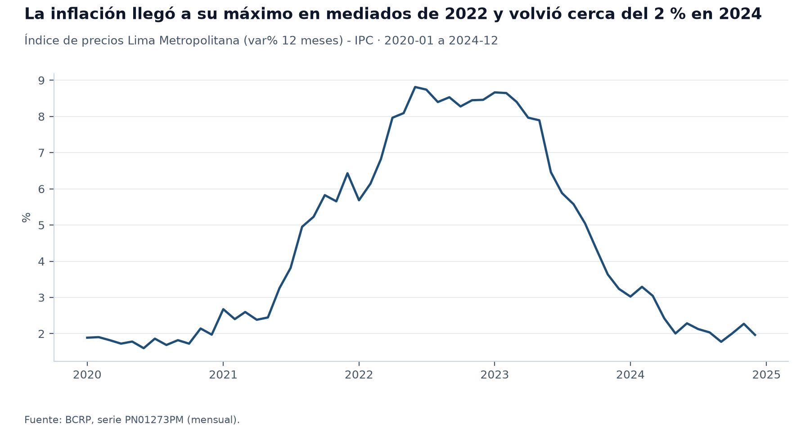
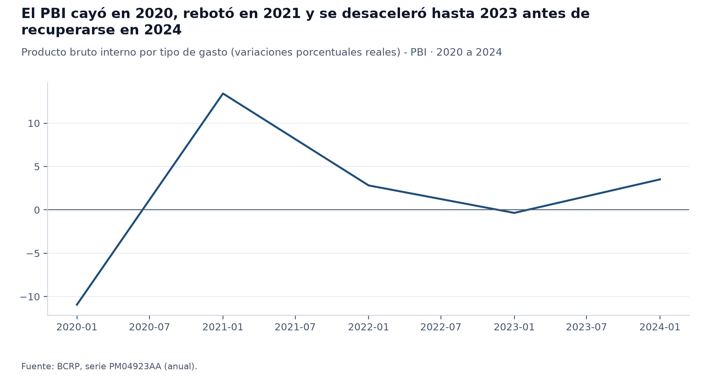
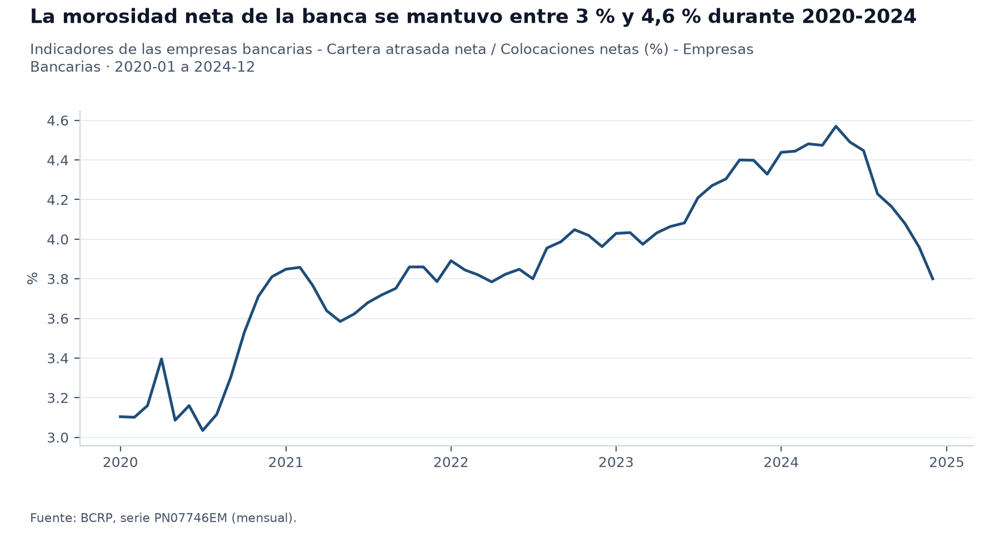
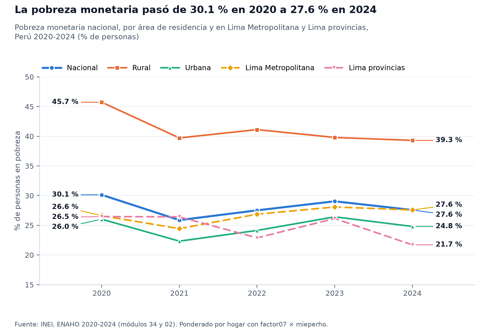
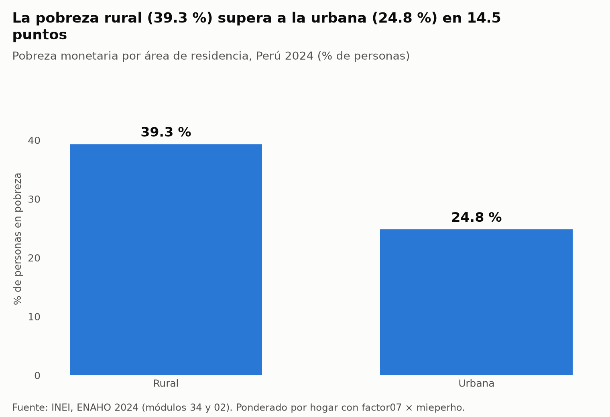
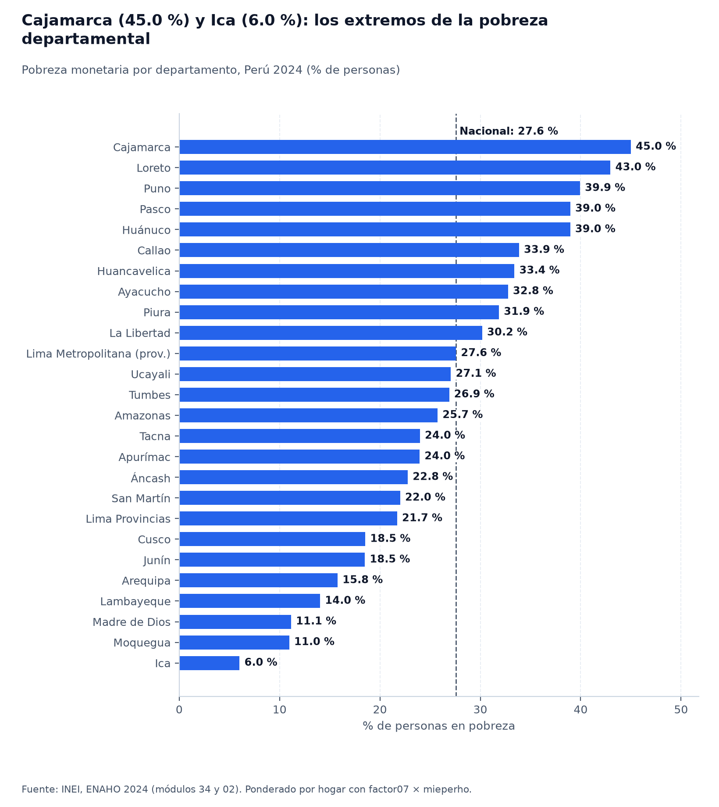
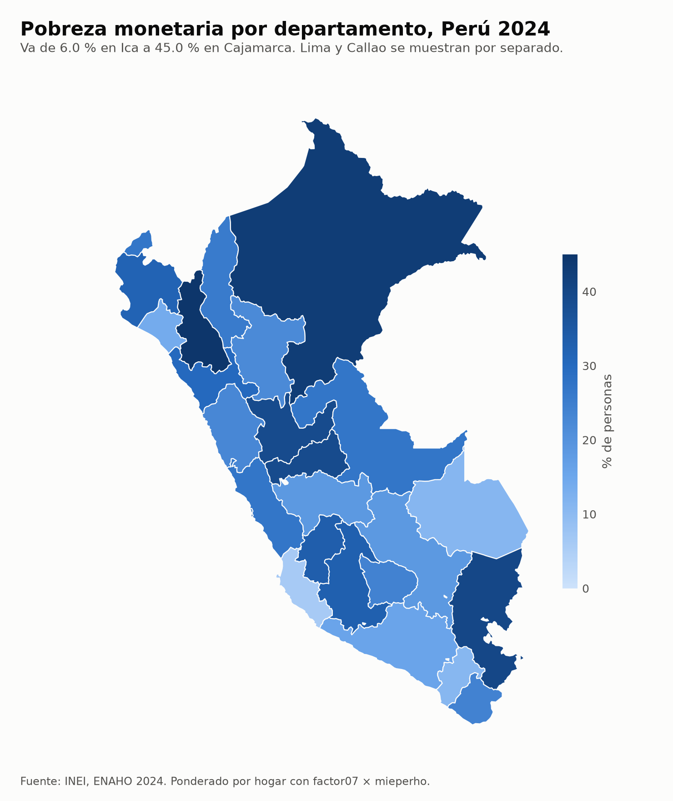
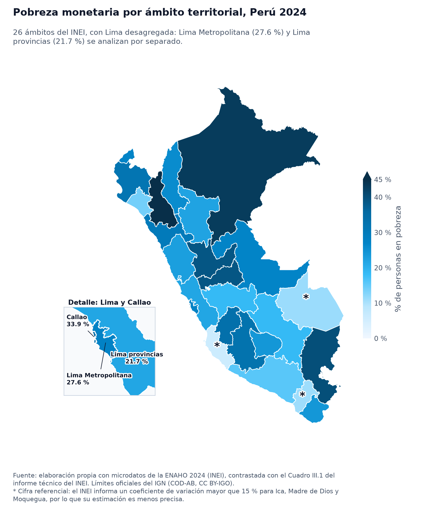

# Inflación, actividad, morosidad y pobreza en el Perú, 2020-2024

## 1. Pregunta de investigación

¿Cómo evolucionaron la inflación, la actividad económica, la morosidad bancaria y la pobreza monetaria del Perú entre 2020 y 2024, y qué brechas territoriales y urbano-rurales presentaba la pobreza en 2024?

El informe cubre enero de 2020 a diciembre de 2024 en las series mensuales (BCRP) y los cierres de diciembre de cada año (SBS); la pobreza proviene de la ENAHO anual de 2020 a 2024 y su foto territorial es la de 2024. La inflación es la de Lima Metropolitana, no nacional. No se pretende demostrar relaciones causales entre indicadores: se comparan series de distinto nivel de agregación y frecuencia.

## 2. Fuentes y metodología

- **BCRP** (servidor MCP `bcrp`): inflación `PN01273PM` (IPC de Lima Metropolitana, variación porcentual en 12 meses), actividad `PN01728AM` (PBI, variación porcentual interanual mensual) y `PM04923AA` (PBI real, variación porcentual anual), y morosidad neta `PN07746EM` (cartera atrasada neta sobre colocaciones netas de las empresas bancarias), todas de 2020 a 2024.
- **SBS** (servidor MCP `sbs`): boletín `B-2401`, indicador «Créditos Atrasados (criterio SBS) / Créditos Directos» de la banca múltiple al cierre de cada diciembre de 2020 a 2024, y boletín `C-1301` de cajas municipales a diciembre de 2024 como contexto financiero.
- **ENAHO 2020-2024 (INEI)**: módulos 34 y 02, residentes habituales, factores de expansión `factor07 × mieperho` (hogar) y `facpob07` (persona), procesados con la skill `limpiando-enaho` y validados contra el informe técnico del INEI (Cuadros III.1 y III.4) sin ninguna falla.
- **Mapas**: límites oficiales del IGN, uniendo por código; Lima se muestra desagregada en Lima Metropolitana y Lima provincias.
- Las dos medidas de morosidad no son equivalentes: la del BCRP es **neta** de provisiones y la de la SBS es **bruta** (atrasados sobre créditos directos). Se presentan por separado y no se mezclan.

## 3. Resultados

1. **Inflación y actividad (BCRP).** La inflación a 12 meses (`PN01273PM`) partió en {{bcrp.resumen(codigo=PN01273PM, desde=2020-01, hasta=2024-12).primero.valor|1}} % en {{bcrp.resumen(codigo=PN01273PM, desde=2020-01, hasta=2024-12).primero.periodo}}, tocó su mínimo de {{bcrp.resumen(codigo=PN01273PM, desde=2020-01, hasta=2024-12).minimo.valor|1}} % en {{bcrp.resumen(codigo=PN01273PM, desde=2020-01, hasta=2024-12).minimo.periodo}}, alcanzó su máximo de {{bcrp.resumen(codigo=PN01273PM, desde=2020-01, hasta=2024-12).maximo.valor|1}} % en {{bcrp.resumen(codigo=PN01273PM, desde=2020-01, hasta=2024-12).maximo.periodo}} y cerró en {{bcrp.resumen(codigo=PN01273PM, desde=2020-01, hasta=2024-12).ultimo.valor|1}} % en {{bcrp.resumen(codigo=PN01273PM, desde=2020-01, hasta=2024-12).ultimo.periodo}}; el promedio del periodo fue {{bcrp.resumen(codigo=PN01273PM, desde=2020-01, hasta=2024-12).promedio|1}} %. La actividad, medida por la variación anual del PBI real (`PM04923AA`), fue {{bcrp.serie(codigo=PM04923AA, desde=2020, hasta=2020).datos[0].valor|1}} % en 2020, {{bcrp.serie(codigo=PM04923AA, desde=2021, hasta=2021).datos[0].valor|1}} % en 2021, {{bcrp.serie(codigo=PM04923AA, desde=2022, hasta=2022).datos[0].valor|1}} % en 2022, {{bcrp.serie(codigo=PM04923AA, desde=2023, hasta=2023).datos[0].valor|1}} % en 2023 y {{bcrp.serie(codigo=PM04923AA, desde=2024, hasta=2024).datos[0].valor|1}} % en 2024. En la serie mensual (`PN01728AM`) el mínimo interanual fue {{bcrp.resumen(codigo=PN01728AM, desde=2020-01, hasta=2024-12).minimo.valor|1}} % en {{bcrp.resumen(codigo=PN01728AM, desde=2020-01, hasta=2024-12).minimo.periodo}} y el máximo {{bcrp.resumen(codigo=PN01728AM, desde=2020-01, hasta=2024-12).maximo.valor|1}} % en {{bcrp.resumen(codigo=PN01728AM, desde=2020-01, hasta=2024-12).maximo.periodo}}, un rebote sobre una base deprimida.
2. **Morosidad bancaria (BCRP y SBS).** La morosidad neta del BCRP (`PN07746EM`) fue {{bcrp.resumen(codigo=PN07746EM, desde=2020-01, hasta=2024-12).primero.valor|1}} % en {{bcrp.resumen(codigo=PN07746EM, desde=2020-01, hasta=2024-12).primero.periodo}}, tuvo su mínimo de {{bcrp.resumen(codigo=PN07746EM, desde=2020-01, hasta=2024-12).minimo.valor|1}} % en {{bcrp.resumen(codigo=PN07746EM, desde=2020-01, hasta=2024-12).minimo.periodo}}, su máximo de {{bcrp.resumen(codigo=PN07746EM, desde=2020-01, hasta=2024-12).maximo.valor|1}} % en {{bcrp.resumen(codigo=PN07746EM, desde=2020-01, hasta=2024-12).maximo.periodo}} y cerró en {{bcrp.resumen(codigo=PN07746EM, desde=2020-01, hasta=2024-12).ultimo.valor|1}} % en {{bcrp.resumen(codigo=PN07746EM, desde=2020-01, hasta=2024-12).ultimo.periodo}}. Con el criterio bruto de la SBS (boletín `B-2401`, total de la banca múltiple), la morosidad al cierre de cada año fue {{sbs.indicadores(tipo_entidad=bancos, indicador=morosidad, periodo=2020-12).indicadores[0].total.valor|2}} % en 2020, {{sbs.indicadores(tipo_entidad=bancos, indicador=morosidad, periodo=2021-12).indicadores[0].total.valor|2}} % en 2021, {{sbs.indicadores(tipo_entidad=bancos, indicador=morosidad, periodo=2022-12).indicadores[0].total.valor|2}} % en 2022, {{sbs.indicadores(tipo_entidad=bancos, indicador=morosidad, periodo=2023-12).indicadores[0].total.valor|2}} % en 2023 y {{sbs.indicadores(tipo_entidad=bancos, indicador=morosidad, periodo=2024-12).indicadores[0].total.valor|2}} % en 2024. Como contexto, las cajas municipales cerraron 2024 con {{sbs.indicadores(tipo_entidad=cajas municipales, indicador=morosidad, periodo=2024-12).indicadores[0].total.valor|2}} % (boletín `C-1301`, diciembre de 2024).
3. **Pobreza monetaria (ENAHO).** La pobreza nacional pasó de {{enaho.pobreza_nacional:2020}} % en 2020 a {{enaho.pobreza_nacional:2021}} % en 2021, {{enaho.pobreza_nacional:2022}} % en 2022, {{enaho.pobreza_nacional:2023}} % en 2023 y {{enaho.pobreza_nacional:2024}} % en 2024 (`pobreza_nacional`). La urbana fue {{enaho.pobreza_area_urbana:2020}} % en 2020 y {{enaho.pobreza_area_urbana:2024}} % en 2024; la rural, {{enaho.pobreza_area_rural:2020}} % en 2020 y {{enaho.pobreza_area_rural:2024}} % en 2024 (`pobreza_area_urbana`, `pobreza_area_rural`). Lima Metropolitana pasó de {{enaho.pobreza_lima_metropolitana_provincia:2020}} % en 2020 a {{enaho.pobreza_lima_metropolitana_provincia:2024}} % en 2024.
4. **Brechas en 2024 (ENAHO).** La pobreza rural fue {{enaho.pobreza_area_rural:2024}} % y la urbana {{enaho.pobreza_area_urbana:2024}} % (`pobreza_area_rural`, `pobreza_area_urbana`), es decir, el campo supera a la ciudad. Entre ámbitos, Cajamarca registró {{enaho.pobreza_dep_06}} % (`pobreza_dep_06`) y Loreto {{enaho.pobreza_dep_16}} % (`pobreza_dep_16`), frente a {{enaho.pobreza_dep_04}} % en Arequipa (`pobreza_dep_04`); Ica ({{enaho.pobreza_dep_11}} %, `pobreza_dep_11`) tuvo la cifra más baja, aunque el INEI la publica como referencial por su coeficiente de variación. Lima Metropolitana tuvo {{enaho.pobreza_lima_metropolitana_provincia}} % y Lima provincias {{enaho.pobreza_lima_provincias}} %.

## 4. Visualizaciones

## 5. Interpretación

Los cuatro indicadores no se mueven juntos. La inflación subió hasta mediados de 2022 y bajó después, mientras la pobreza cayó en 2021, subió en 2022 y 2023 y bajó en 2024; la morosidad bancaria se movió en un rango estrecho. La correlación mensual entre la inflación y la morosidad neta es {{bcrp.comparar_series(codigo_a=PN01273PM, codigo_b=PN07746EM, desde=2020-01, hasta=2024-12).correlacion|2}} (`comparar_series`), una asociación débil que no permite atribuir una a la otra. Comparar series nacionales mensuales con una encuesta anual por ámbito mezcla niveles de agregación y de tiempo, y la inflación es solo la de Lima Metropolitana. Las diferencias entre ámbitos de 2024 son descriptivas, y las distancias menores entre ámbitos caben dentro de los intervalos de confianza del INEI.

## 6. Limitaciones

- La morosidad neta del BCRP y la bruta de la SBS tienen definiciones distintas y no son comparables entre sí; la SBS se toma solo al cierre de diciembre de cada año.
- La ENAHO es una encuesta con error muestral: las cifras departamentales tienen intervalos de confianza amplios, y Ica, Madre de Dios y Moquegua son referenciales (coeficiente de variación mayor que {{lit:15 %}}).
- El INEI no publica una cifra para el departamento de Lima en conjunto; el mapa departamental de la consigna muestra un cálculo propio con los microdatos, y el análisis usa Lima desagregada.
- La inflación cubre solo Lima Metropolitana.
- No se estima ninguna relación causal.
- **Verificación de consistencia** (`salidas/consistencia.md`): no hubo fallas. Todas las comprobaciones de la ENAHO, del IPC y de las cifras de este informe resultaron OK. La única DIFERENCIA esperada es la morosidad de diciembre de cada año: el BCRP (`PN07746EM`, neta) y la SBS (`B-2401`, bruta) difieren en como máximo {{lit:0.05 puntos}} porque miden cosas distintas.

## 7. Reproducibilidad

Insumos: `salidas/indicadores.csv` (skill `limpiando-enaho`), `figuras/` (skill `graficando-enaho` y `graficar_serie`), `mapas/` (skill `mapeando-enaho`). Series del BCRP: `PN01273PM`, `PN01728AM`, `PM04923AA` y `PN07746EM`, 2020 a 2024. Boletines SBS: `B-2401` y `C-1301`. El informe se regenera con `uv run .claude/skills/informando-peru/scripts/armar_informe.py`.
