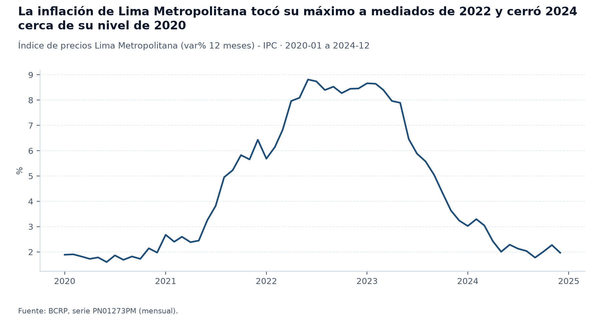
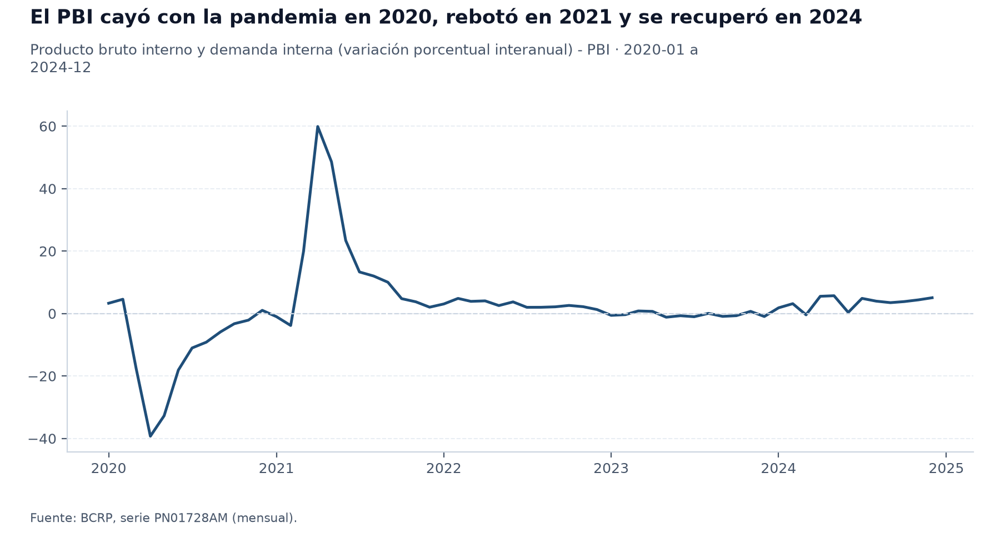
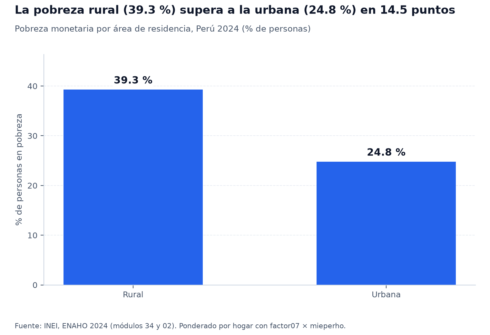
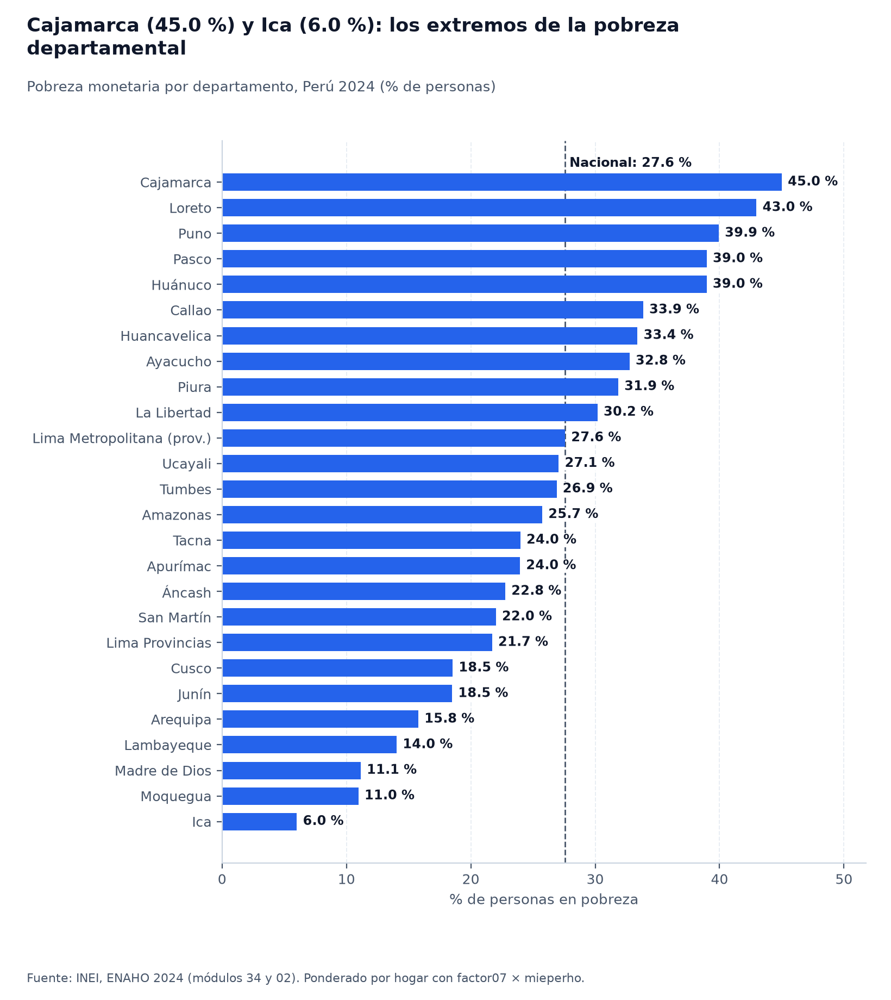
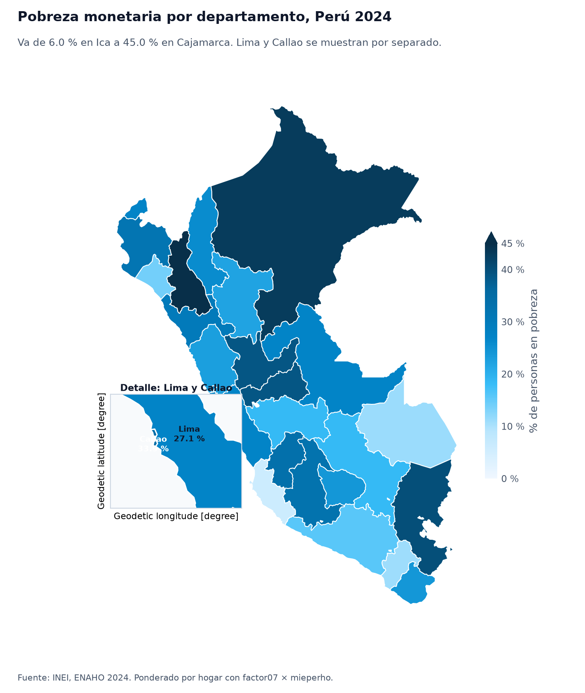

# Inflación, actividad y pobreza en el Perú: 2020-2024 y la foto territorial de 2024

## 1. Pregunta de investigación

¿Cómo evolucionaron la inflación y la actividad económica del Perú entre 2020 y 2024, y qué brechas territoriales y urbano-rurales presentaba la pobreza monetaria en 2024?

El informe cubre tres periodos distintos: las series mensuales del BCRP de enero de 2020 a diciembre de 2024, el boletín de la SBS de diciembre de 2024 y la ENAHO 2024 del INEI, una encuesta anual con alcance nacional y departamental. No se pretende demostrar ninguna relación causal entre la macroeconomía y la pobreza.

## 2. Fuentes y metodología

- **BCRP**: `PN01273PM` (IPC de Lima Metropolitana, variación porcentual a 12 meses) y `PN01728AM` (PBI, variación porcentual interanual), ambas mensuales, de 2020-01 a 2024-12, consultadas con el servidor MCP `bcrp`.
- **SBS**: boletines B-2401 (indicadores de bancos), C-1301 (indicadores de cajas municipales) y B-2332 (ranking de créditos), periodo 2024-12, consultados con el servidor MCP `sbs`.
- **ENAHO 2024 (INEI)**: módulos 34 y 02, residentes habituales, factores de expansión `factor07 × mieperho` (hogar) y `facpob07` (persona), procesados con la skill `limpiando-enaho`. La pobreza por área y por departamento se pondera por hogar, como las cifras oficiales del INEI.
- El promedio anual del PBI es el promedio de las doce variaciones interanuales mensuales del año, no el crecimiento anual oficial.

## 3. Resultados

1. **Inflación (BCRP).** Según `PN01273PM`, la inflación a 12 meses pasó de 2.0% en diciembre de 2020 a 6.4% en diciembre de 2021, tocó su máximo de 8.8% en 2022-06, y cerró en 8.5% (2022), 3.2% (2023) y 2.0% (2024) en cada diciembre. Su mínimo del periodo fue 1.6% en 2020-06, y el promedio de los 60 meses, 4.5%.
2. **Actividad (BCRP).** Según `PN01728AM`, el PBI varió -39.3% interanual en 2020-04 (su mínimo) y rebotó 59.9% en 2021-04. El promedio de las variaciones mensuales fue -10.9% en 2020, 16.1% en 2021, 2.9% en 2022, -0.3% en 2023 y 3.5% en 2024; diciembre de 2024 cerró en 5.1%.
3. **Pobreza por área (ENAHO 2024).** La pobreza monetaria nacional fue 27.6% y la pobreza extrema, 5.5% (indicadores `pobreza_nacional` y `pobreza_extrema`). En el área rural fue 39.3% y en la urbana, 24.8% (`pobreza_area_rural`, `pobreza_area_urbana`): la pobreza rural fue claramente mayor. Lima Metropolitana tuvo 28.2% (`pobreza_lima_metropolitana`).
4. **Pobreza por departamento (ENAHO 2024).** Cajamarca (45.0%), Loreto (43.0%), Puno (39.9%), Pasco (39.0%) y Huánuco (39.0%) fueron los cinco departamentos con mayor pobreza; Ica (6.0%), Moquegua (11.0%), Madre de Dios (11.1%), Lambayeque (14.0%) y Arequipa (15.8%) fueron los cinco con menor pobreza (indicadores `pobreza_dep_06`, `_16`, `_21`, `_19`, `_10`, `_11`, `_18`, `_17`, `_14` y `_04`). El Callao tuvo 33.9% y Lima, 27.1%, por lo que ambos van separados.
5. **Contexto financiero (SBS, diciembre de 2024).** La morosidad (créditos atrasados sobre créditos directos) fue 3.75% en la banca múltiple (B-2401) y 5.98% en las cajas municipales (C-1301). Los tres mayores bancos concentraron 70.0% de los créditos directos (B-2332).
6. **Ambas fuentes lado a lado.** Al cierre de 2024, la inflación de Lima Metropolitana volvió a 2.0% (`PN01273PM`, 2024-12) y el PBI crecía 5.1% interanual (`PN01728AM`, 2024-12), mientras que la ENAHO 2024 registraba una pobreza nacional de 27.6% con la brecha rural-urbana y la dispersión departamental descritas arriba. La correlación mensual entre inflación y PBI interanual en 2020-2024 fue 0.05, prácticamente nula, en una muestra dominada por la pandemia.

## 4. Visualizaciones

## 5. Interpretación

- La inflación tuvo un ciclo claro: subió desde 2020, alcanzó su máximo a mediados de 2022 y volvió hacia el rango habitual hacia fines de 2024, según `PN01273PM`.
- La actividad fue muy volátil en 2020 y 2021 por el efecto base de la pandemia: la caída y el rebote de `PN01728AM` son en gran parte espejos uno del otro, no dos fenómenos independientes.
- La pobreza de 2024 se asocia a un patrón territorial: mayor en departamentos andinos y amazónicos del norte, centro y sur (Cajamarca, Loreto, Puno) y menor en departamentos costeros del sur y del norte (Ica, Moquegua, Lambayeque). La rural supera a la urbana. Son asociaciones descriptivas de una encuesta de un año.
- La inflación (Lima Metropolitana, mensual, serie nacional de precios) y la pobreza (hogares, anual, por departamento) tienen distinto nivel de agregación y periodo: ponerlas juntas ilustra el contexto, no prueba relación alguna.

## 6. Limitaciones

- El IPC del BCRP es de Lima Metropolitana, no nacional; la pobreza de la ENAHO es nacional y por departamento.
- La ENAHO se procesó solo para 2024: este informe no describe cómo cambió la pobreza entre 2020 y 2024.
- La serie de PBI es la variación interanual mensual; los promedios anuales de este informe no son el crecimiento anual oficial.
- Las cifras de pobreza vienen de una muestra y tienen error de muestreo; las diferencias entre departamentos cercanos pueden no ser significativas.
- La morosidad de la SBS es una foto de un mes (2024-12) y no hay serie 2020-2024 en este informe.
- Todas las herramientas respondieron sin errores durante la ejecución.

## 7. Reproducibilidad

- Plan: `informes/plan_analisis.md`; borrador: `informes/borrador.md`.
- ENAHO: `.claude/skills/limpiando-enaho/scripts/limpiar.py --anio 2024` produce `salidas/personas_2024.parquet`, `salidas/indicadores.csv` y `salidas/validacion.txt`; `graficar.py` y `mapear.py` producen `figuras/` y `mapas/`.
- BCRP: series `PN01273PM` y `PN01728AM`, 2020-01 a 2024-12.
- SBS: B-2401, C-1301 y B-2332, 2024-12.
- Verificación de consistencia (`verificando-consistencia`, detalle en `salidas/consistencia.md`): todas las comprobaciones resultaron OK, sin diferencias, fallas ni datos no verificables; incluye el contraste de cada cifra de este informe con una nueva consulta a sus herramientas.
- Regenerar: `uv run .claude/skills/informando-peru/scripts/armar_informe.py`.

## Trazabilidad de las cifras

Cada cifra del informe se generó con `armar_informe.py` desde `informes/borrador.md` el 2026-11-05 14:41, sobre el commit `1779b27`. Ninguna se escribió a mano.

| # | Cifra | Origen | Fuente |
|---|---|---|---|
| 1 | 2.0 | `bcrp.resumen(codigo=PN01273PM, desde=2020-12, hasta=2020-12).ultimo.valor` | https://estadisticas.bcrp.gob.pe/estadisticas/series/api/PN01273PM/json/2020-12/2020-12 |
| 2 | 6.4 | `bcrp.resumen(codigo=PN01273PM, desde=2021-12, hasta=2021-12).ultimo.valor` | https://estadisticas.bcrp.gob.pe/estadisticas/series/api/PN01273PM/json/2021-12/2021-12 |
| 3 | 8.8 | `bcrp.resumen(codigo=PN01273PM, desde=2020-01, hasta=2024-12).maximo.valor` | https://estadisticas.bcrp.gob.pe/estadisticas/series/api/PN01273PM/json/2020-1/2024-12 |
| 4 | 2022-06 | `bcrp.resumen(codigo=PN01273PM, desde=2020-01, hasta=2024-12).maximo.periodo` | https://estadisticas.bcrp.gob.pe/estadisticas/series/api/PN01273PM/json/2020-1/2024-12 |
| 5 | 8.5 | `bcrp.resumen(codigo=PN01273PM, desde=2022-12, hasta=2022-12).ultimo.valor` | https://estadisticas.bcrp.gob.pe/estadisticas/series/api/PN01273PM/json/2022-12/2022-12 |
| 6 | 3.2 | `bcrp.resumen(codigo=PN01273PM, desde=2023-12, hasta=2023-12).ultimo.valor` | https://estadisticas.bcrp.gob.pe/estadisticas/series/api/PN01273PM/json/2023-12/2023-12 |
| 7 | 2.0 | `bcrp.resumen(codigo=PN01273PM, desde=2024-12, hasta=2024-12).ultimo.valor` | https://estadisticas.bcrp.gob.pe/estadisticas/series/api/PN01273PM/json/2024-12/2024-12 |
| 8 | 1.6 | `bcrp.resumen(codigo=PN01273PM, desde=2020-01, hasta=2024-12).minimo.valor` | https://estadisticas.bcrp.gob.pe/estadisticas/series/api/PN01273PM/json/2020-1/2024-12 |
| 9 | 2020-06 | `bcrp.resumen(codigo=PN01273PM, desde=2020-01, hasta=2024-12).minimo.periodo` | https://estadisticas.bcrp.gob.pe/estadisticas/series/api/PN01273PM/json/2020-1/2024-12 |
| 10 | 4.5 | `bcrp.resumen(codigo=PN01273PM, desde=2020-01, hasta=2024-12).promedio` | https://estadisticas.bcrp.gob.pe/estadisticas/series/api/PN01273PM/json/2020-1/2024-12 |
| 11 | -39.3 | `bcrp.resumen(codigo=PN01728AM, desde=2020-01, hasta=2024-12).minimo.valor` | https://estadisticas.bcrp.gob.pe/estadisticas/series/api/PN01728AM/json/2020-1/2024-12 |
| 12 | 2020-04 | `bcrp.resumen(codigo=PN01728AM, desde=2020-01, hasta=2024-12).minimo.periodo` | https://estadisticas.bcrp.gob.pe/estadisticas/series/api/PN01728AM/json/2020-1/2024-12 |
| 13 | 59.9 | `bcrp.resumen(codigo=PN01728AM, desde=2020-01, hasta=2024-12).maximo.valor` | https://estadisticas.bcrp.gob.pe/estadisticas/series/api/PN01728AM/json/2020-1/2024-12 |
| 14 | 2021-04 | `bcrp.resumen(codigo=PN01728AM, desde=2020-01, hasta=2024-12).maximo.periodo` | https://estadisticas.bcrp.gob.pe/estadisticas/series/api/PN01728AM/json/2020-1/2024-12 |
| 15 | -10.9 | `bcrp.resumen(codigo=PN01728AM, desde=2020-01, hasta=2020-12).promedio` | https://estadisticas.bcrp.gob.pe/estadisticas/series/api/PN01728AM/json/2020-1/2020-12 |
| 16 | 16.1 | `bcrp.resumen(codigo=PN01728AM, desde=2021-01, hasta=2021-12).promedio` | https://estadisticas.bcrp.gob.pe/estadisticas/series/api/PN01728AM/json/2021-1/2021-12 |
| 17 | 2.9 | `bcrp.resumen(codigo=PN01728AM, desde=2022-01, hasta=2022-12).promedio` | https://estadisticas.bcrp.gob.pe/estadisticas/series/api/PN01728AM/json/2022-1/2022-12 |
| 18 | -0.3 | `bcrp.resumen(codigo=PN01728AM, desde=2023-01, hasta=2023-12).promedio` | https://estadisticas.bcrp.gob.pe/estadisticas/series/api/PN01728AM/json/2023-1/2023-12 |
| 19 | 3.5 | `bcrp.resumen(codigo=PN01728AM, desde=2024-01, hasta=2024-12).promedio` | https://estadisticas.bcrp.gob.pe/estadisticas/series/api/PN01728AM/json/2024-1/2024-12 |
| 20 | 5.1 | `bcrp.resumen(codigo=PN01728AM, desde=2024-12, hasta=2024-12).ultimo.valor` | https://estadisticas.bcrp.gob.pe/estadisticas/series/api/PN01728AM/json/2024-12/2024-12 |
| 21 | 27.6 | `enaho.pobreza_nacional`: Pobreza monetaria, Nacional (% de personas) | salidas/indicadores.csv; ponderador factor07 × mieperho (por hogar); n = 33,691 |
| 22 | 5.5 | `enaho.pobreza_extrema`: Pobreza extrema, Nacional (% de personas) | salidas/indicadores.csv; ponderador factor07 × mieperho (por hogar); n = 33,691 |
| 23 | 39.3 | `enaho.pobreza_area_rural`: Pobreza monetaria, Rural (% de personas) | salidas/indicadores.csv; ponderador factor07 × mieperho (por hogar); n = 11,660 |
| 24 | 24.8 | `enaho.pobreza_area_urbana`: Pobreza monetaria, Urbana (% de personas) | salidas/indicadores.csv; ponderador factor07 × mieperho (por hogar); n = 22,031 |
| 25 | 28.2 | `enaho.pobreza_lima_metropolitana`: Pobreza monetaria, Lima Metropolitana (% de personas) | salidas/indicadores.csv; ponderador factor07 × mieperho (por hogar); n = 4,090 |
| 26 | 45.0 | `enaho.pobreza_dep_06`: Pobreza monetaria, Cajamarca (% de personas) | salidas/indicadores.csv; ponderador factor07 × mieperho (por hogar); n = 1,469 |
| 27 | 43.0 | `enaho.pobreza_dep_16`: Pobreza monetaria, Loreto (% de personas) | salidas/indicadores.csv; ponderador factor07 × mieperho (por hogar); n = 1,359 |
| 28 | 39.9 | `enaho.pobreza_dep_21`: Pobreza monetaria, Puno (% de personas) | salidas/indicadores.csv; ponderador factor07 × mieperho (por hogar); n = 1,123 |
| 29 | 39.0 | `enaho.pobreza_dep_19`: Pobreza monetaria, Pasco (% de personas) | salidas/indicadores.csv; ponderador factor07 × mieperho (por hogar); n = 865 |
| 30 | 39.0 | `enaho.pobreza_dep_10`: Pobreza monetaria, Huánuco (% de personas) | salidas/indicadores.csv; ponderador factor07 × mieperho (por hogar); n = 1,244 |
| 31 | 6.0 | `enaho.pobreza_dep_11`: Pobreza monetaria, Ica (% de personas) | salidas/indicadores.csv; ponderador factor07 × mieperho (por hogar); n = 1,500 |
| 32 | 11.0 | `enaho.pobreza_dep_18`: Pobreza monetaria, Moquegua (% de personas) | salidas/indicadores.csv; ponderador factor07 × mieperho (por hogar); n = 963 |
| 33 | 11.1 | `enaho.pobreza_dep_17`: Pobreza monetaria, Madre de Dios (% de personas) | salidas/indicadores.csv; ponderador factor07 × mieperho (por hogar); n = 603 |
| 34 | 14.0 | `enaho.pobreza_dep_14`: Pobreza monetaria, Lambayeque (% de personas) | salidas/indicadores.csv; ponderador factor07 × mieperho (por hogar); n = 1,302 |
| 35 | 15.8 | `enaho.pobreza_dep_04`: Pobreza monetaria, Arequipa (% de personas) | salidas/indicadores.csv; ponderador factor07 × mieperho (por hogar); n = 1,506 |
| 36 | 33.9 | `enaho.pobreza_dep_07`: Pobreza monetaria, Callao (% de personas) | salidas/indicadores.csv; ponderador factor07 × mieperho (por hogar); n = 1,027 |
| 37 | 27.1 | `enaho.pobreza_dep_15`: Pobreza monetaria, Lima (% de personas) | salidas/indicadores.csv; ponderador factor07 × mieperho (por hogar); n = 4,544 |
| 38 | 3.75 | `sbs.indicadores(tipo_entidad=bancos, indicador=morosidad, periodo=2024-12).indicadores[0].total.valor` | https://intranet2.sbs.gob.pe/estadistica/financiera/2024/Diciembre/B-2401-di2024.XLS |
| 39 | 5.98 | `sbs.indicadores(tipo_entidad=cajas municipales, indicador=morosidad, periodo=2024-12).indicadores[0].total.valor` | https://intranet2.sbs.gob.pe/estadistica/financiera/2024/Diciembre/C-1301-di2024.XLS |
| 40 | 70.0 | `sbs.ranking(tipo_entidad=bancos, concepto=creditos, periodo=2024-12, limite=3).ranking[2].acumulado_pct` | https://intranet2.sbs.gob.pe/estadistica/financiera/2024/Diciembre/B-2332-di2024.XLS |
| 41 | 0.05 | `bcrp.comparar_series(codigo_a=PN01273PM, codigo_b=PN01728AM, desde=2020-01, hasta=2024-12).correlacion` | https://estadisticas.bcrp.gob.pe/estadisticas/series/api/PN01273PM/json/2020-1/2024-12, https://estadisticas.bcrp.gob.pe/estadisticas/series/api/PN01728AM/json/2020-1/2024-12 |

## Referencias

### Fuentes oficiales consultadas (norma APA 7ma edición)

- Banco Central de Reserva del Perú. (2025). *Estadísticas económicas: Series de inflación y actividad económica* [Servicio web de datos / API]. https://estadisticas.bcrp.gob.pe/estadisticas/series/api/
- Instituto Nacional de Estadística e Informática. (2025a). *Encuesta Nacional de Hogares sobre Condiciones de Vida y Pobreza 2024* [Microdatos, módulos 34 y 02]. https://proyectos.inei.gob.pe/iinei/srienaho/descarga/STATA/
- Instituto Nacional de Estadística e Informática. (2025b). *Perú: Evolución de la Pobreza Monetaria 2015-2024. Informe técnico*. Lima: INEI. https://cdn.www.gob.pe/uploads/document/file/8058556/6763186-peru-evolucion-de-la-pobreza-monetaria-2015-2024.pdf
- Superintendencia de Banca, Seguros y AFP. (2024). *Boletín Estadístico de Banca Múltiple y Cajas Municipales (Diciembre 2024)* [Boletines B-2401, C-1301 y B-2332]. https://intranet2.sbs.gob.pe/estadistica/financiera/

### Trazabilidad y procesamiento de código

- Procesamiento de microdatos: `.claude/skills/limpiando-enaho/scripts/limpiar.py` → `salidas/indicadores.csv`, `salidas/validacion.txt`.
- Servidor MCP del BCRP: `mcp/server.py`; servidores SBS y Fetch en `.mcp.json`.
