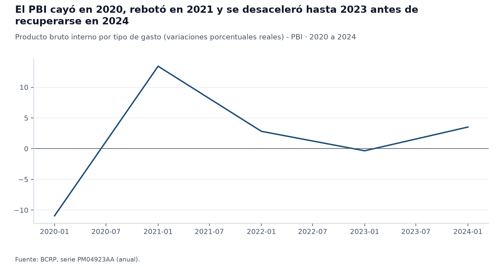
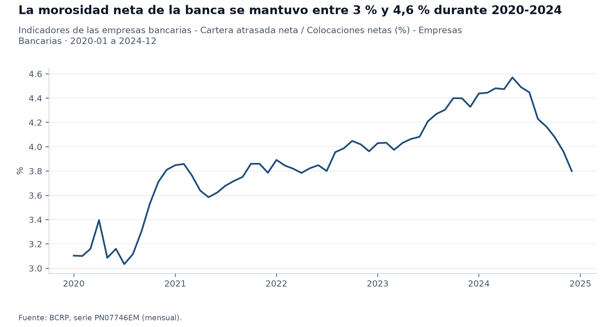
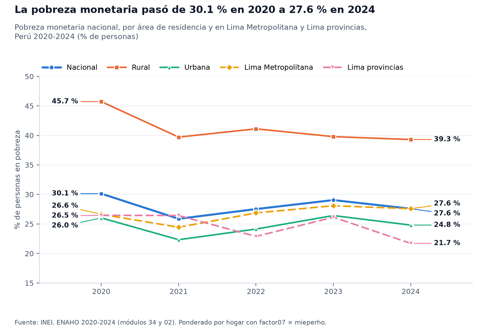
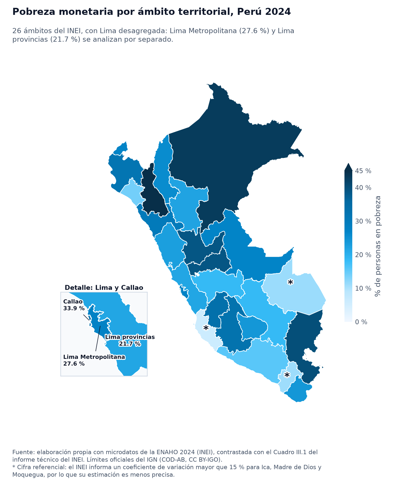

# Inflación, actividad, morosidad y pobreza en el Perú, 2020-2024

## 1. Pregunta de investigación

¿Cómo evolucionaron la inflación, la actividad económica, la morosidad bancaria y la pobreza monetaria del Perú entre 2020 y 2024, y qué brechas territoriales y urbano-rurales presentaba la pobreza en 2024?

El informe cubre enero de 2020 a diciembre de 2024 en las series mensuales (BCRP) y los cierres de diciembre de cada año (SBS); la pobreza proviene de la ENAHO anual de 2020 a 2024 y su foto territorial es la de 2024. La inflación es la de Lima Metropolitana, no nacional. No se pretende demostrar relaciones causales entre indicadores: se comparan series de distinto nivel de agregación y frecuencia.

## 2. Fuentes y metodología

- **BCRP** (servidor MCP `bcrp`): inflación `PN01273PM` (IPC de Lima Metropolitana, variación porcentual en 12 meses), actividad `PN01728AM` (PBI, variación porcentual interanual mensual) y `PM04923AA` (PBI real, variación porcentual anual), y morosidad neta `PN07746EM` (cartera atrasada neta sobre colocaciones netas de las empresas bancarias), todas de 2020 a 2024.
- **SBS** (servidor MCP `sbs`): boletín `B-2401`, indicador «Créditos Atrasados (criterio SBS) / Créditos Directos» de la banca múltiple al cierre de cada diciembre de 2020 a 2024, y boletín `C-1301` de cajas municipales a diciembre de 2024 como contexto financiero.
- **ENAHO 2020-2024 (INEI)**: módulos 34 y 02, residentes habituales, factores de expansión `factor07 × mieperho` (hogar) y `facpob07` (persona), procesados con la skill `limpiando-enaho` y validados contra el informe técnico del INEI (Cuadros III.1 y III.4) sin ninguna falla.
- **Mapas**: límites oficiales del IGN, uniendo por código; Lima se muestra desagregada en Lima Metropolitana y Lima provincias.
- Las dos medidas de morosidad no son equivalentes: la del BCRP es **neta** de provisiones y la de la SBS es **bruta** (atrasados sobre créditos directos). Se presentan por separado y no se mezclan.

## 3. Resultados

1. **Inflación y actividad (BCRP).** La inflación a 12 meses (`PN01273PM`) partió en 1.9 % en 2020-01, tocó su mínimo de 1.6 % en 2020-06, alcanzó su máximo de 8.8 % en 2022-06 y cerró en 2.0 % en 2024-12; el promedio del periodo fue 4.5 %. La actividad, medida por la variación anual del PBI real (`PM04923AA`), fue -10.9 % en 2020, 13.4 % en 2021, 2.8 % en 2022, -0.4 % en 2023 y 3.5 % en 2024. En la serie mensual (`PN01728AM`) el mínimo interanual fue -39.3 % en 2020-04 y el máximo 59.9 % en 2021-04, un rebote sobre una base deprimida.
2. **Morosidad bancaria (BCRP y SBS).** La morosidad neta del BCRP (`PN07746EM`) fue 3.1 % en 2020-01, tuvo su mínimo de 3.0 % en 2020-07, su máximo de 4.6 % en 2024-05 y cerró en 3.8 % en 2024-12. Con el criterio bruto de la SBS (boletín `B-2401`, total de la banca múltiple), la morosidad al cierre de cada año fue 3.80 % en 2020, 3.77 % en 2021, 3.95 % en 2022, 4.31 % en 2023 y 3.75 % en 2024. Como contexto, las cajas municipales cerraron 2024 con 5.98 % (boletín `C-1301`, diciembre de 2024).
3. **Pobreza monetaria (ENAHO).** La pobreza nacional pasó de 30.1 % en 2020 a 25.9 % en 2021, 27.5 % en 2022, 29.0 % en 2023 y 27.6 % en 2024 (`pobreza_nacional`). La urbana fue 26.0 % en 2020 y 24.8 % en 2024; la rural, 45.7 % en 2020 y 39.3 % en 2024 (`pobreza_area_urbana`, `pobreza_area_rural`). Lima Metropolitana pasó de 26.6 % en 2020 a 27.6 % en 2024.
4. **Brechas en 2024 (ENAHO).** La pobreza rural fue 39.3 % y la urbana 24.8 % (`pobreza_area_rural`, `pobreza_area_urbana`), es decir, el campo supera a la ciudad. Entre ámbitos, Cajamarca registró 45.0 % (`pobreza_dep_06`) y Loreto 43.0 % (`pobreza_dep_16`), frente a 15.8 % en Arequipa (`pobreza_dep_04`); Ica (6.0 %, `pobreza_dep_11`) tuvo la cifra más baja, aunque el INEI la publica como referencial por su coeficiente de variación. Lima Metropolitana tuvo 27.6 % y Lima provincias 21.7 %.

## 4. Visualizaciones

## 5. Interpretación

Los cuatro indicadores no se mueven juntos. La inflación subió hasta mediados de 2022 y bajó después, mientras la pobreza cayó en 2021, subió en 2022 y 2023 y bajó en 2024; la morosidad bancaria se movió en un rango estrecho. La correlación mensual entre la inflación y la morosidad neta es 0.24 (`comparar_series`), una asociación débil que no permite atribuir una a la otra. Comparar series nacionales mensuales con una encuesta anual por ámbito mezcla niveles de agregación y de tiempo, y la inflación es solo la de Lima Metropolitana. Las diferencias entre ámbitos de 2024 son descriptivas, y las distancias menores entre ámbitos caben dentro de los intervalos de confianza del INEI.

## 6. Limitaciones

- La morosidad neta del BCRP y la bruta de la SBS tienen definiciones distintas y no son comparables entre sí; la SBS se toma solo al cierre de diciembre de cada año.
- La ENAHO es una encuesta con error muestral: las cifras departamentales tienen intervalos de confianza amplios, y Ica, Madre de Dios y Moquegua son referenciales (coeficiente de variación mayor que 15 %).
- El INEI no publica una cifra para el departamento de Lima en conjunto; el mapa departamental de la consigna muestra un cálculo propio con los microdatos, y el análisis usa Lima desagregada.
- La inflación cubre solo Lima Metropolitana.
- No se estima ninguna relación causal.
- **Verificación de consistencia** (`salidas/consistencia.md`): no hubo fallas. Todas las comprobaciones de la ENAHO, del IPC y de las cifras de este informe resultaron OK. La única DIFERENCIA esperada es la morosidad de diciembre de cada año: el BCRP (`PN07746EM`, neta) y la SBS (`B-2401`, bruta) difieren en como máximo 0.05 puntos porque miden cosas distintas.

## 7. Reproducibilidad

Insumos: `salidas/indicadores.csv` (skill `limpiando-enaho`), `figuras/` (skill `graficando-enaho` y `graficar_serie`), `mapas/` (skill `mapeando-enaho`). Series del BCRP: `PN01273PM`, `PN01728AM`, `PM04923AA` y `PN07746EM`, 2020 a 2024. Boletines SBS: `B-2401` y `C-1301`. El informe se regenera con `uv run .claude/skills/informando-peru/scripts/armar_informe.py`.

## Trazabilidad de las cifras

Cada cifra del informe se generó con `armar_informe.py` desde `informes/borrador.md` el 2026-11-07 09:59, sobre el commit `8614069`, con cambios sin commitear en 3 archivos (`informes/borrador.md`, `salidas/consistencia.csv`, `salidas/consistencia.md`): ese commit por sí solo no reproduce el informe. Ninguna se escribió a mano.

| # | Cifra | Origen | Fuente |
|---|---|---|---|
| 1 | 1.9 | `bcrp.resumen(codigo=PN01273PM, desde=2020-01, hasta=2024-12).primero.valor` | https://estadisticas.bcrp.gob.pe/estadisticas/series/api/PN01273PM/json/2020-1/2024-12 |
| 2 | 2020-01 | `bcrp.resumen(codigo=PN01273PM, desde=2020-01, hasta=2024-12).primero.periodo` | https://estadisticas.bcrp.gob.pe/estadisticas/series/api/PN01273PM/json/2020-1/2024-12 |
| 3 | 1.6 | `bcrp.resumen(codigo=PN01273PM, desde=2020-01, hasta=2024-12).minimo.valor` | https://estadisticas.bcrp.gob.pe/estadisticas/series/api/PN01273PM/json/2020-1/2024-12 |
| 4 | 2020-06 | `bcrp.resumen(codigo=PN01273PM, desde=2020-01, hasta=2024-12).minimo.periodo` | https://estadisticas.bcrp.gob.pe/estadisticas/series/api/PN01273PM/json/2020-1/2024-12 |
| 5 | 8.8 | `bcrp.resumen(codigo=PN01273PM, desde=2020-01, hasta=2024-12).maximo.valor` | https://estadisticas.bcrp.gob.pe/estadisticas/series/api/PN01273PM/json/2020-1/2024-12 |
| 6 | 2022-06 | `bcrp.resumen(codigo=PN01273PM, desde=2020-01, hasta=2024-12).maximo.periodo` | https://estadisticas.bcrp.gob.pe/estadisticas/series/api/PN01273PM/json/2020-1/2024-12 |
| 7 | 2.0 | `bcrp.resumen(codigo=PN01273PM, desde=2020-01, hasta=2024-12).ultimo.valor` | https://estadisticas.bcrp.gob.pe/estadisticas/series/api/PN01273PM/json/2020-1/2024-12 |
| 8 | 2024-12 | `bcrp.resumen(codigo=PN01273PM, desde=2020-01, hasta=2024-12).ultimo.periodo` | https://estadisticas.bcrp.gob.pe/estadisticas/series/api/PN01273PM/json/2020-1/2024-12 |
| 9 | 4.5 | `bcrp.resumen(codigo=PN01273PM, desde=2020-01, hasta=2024-12).promedio` | https://estadisticas.bcrp.gob.pe/estadisticas/series/api/PN01273PM/json/2020-1/2024-12 |
| 10 | -10.9 | `bcrp.serie(codigo=PM04923AA, desde=2020, hasta=2020).datos[0].valor` | https://estadisticas.bcrp.gob.pe/estadisticas/series/api/PM04923AA/json/2020/2020 |
| 11 | 13.4 | `bcrp.serie(codigo=PM04923AA, desde=2021, hasta=2021).datos[0].valor` | https://estadisticas.bcrp.gob.pe/estadisticas/series/api/PM04923AA/json/2021/2021 |
| 12 | 2.8 | `bcrp.serie(codigo=PM04923AA, desde=2022, hasta=2022).datos[0].valor` | https://estadisticas.bcrp.gob.pe/estadisticas/series/api/PM04923AA/json/2022/2022 |
| 13 | -0.4 | `bcrp.serie(codigo=PM04923AA, desde=2023, hasta=2023).datos[0].valor` | https://estadisticas.bcrp.gob.pe/estadisticas/series/api/PM04923AA/json/2023/2023 |
| 14 | 3.5 | `bcrp.serie(codigo=PM04923AA, desde=2024, hasta=2024).datos[0].valor` | https://estadisticas.bcrp.gob.pe/estadisticas/series/api/PM04923AA/json/2024/2024 |
| 15 | -39.3 | `bcrp.resumen(codigo=PN01728AM, desde=2020-01, hasta=2024-12).minimo.valor` | https://estadisticas.bcrp.gob.pe/estadisticas/series/api/PN01728AM/json/2020-1/2024-12 |
| 16 | 2020-04 | `bcrp.resumen(codigo=PN01728AM, desde=2020-01, hasta=2024-12).minimo.periodo` | https://estadisticas.bcrp.gob.pe/estadisticas/series/api/PN01728AM/json/2020-1/2024-12 |
| 17 | 59.9 | `bcrp.resumen(codigo=PN01728AM, desde=2020-01, hasta=2024-12).maximo.valor` | https://estadisticas.bcrp.gob.pe/estadisticas/series/api/PN01728AM/json/2020-1/2024-12 |
| 18 | 2021-04 | `bcrp.resumen(codigo=PN01728AM, desde=2020-01, hasta=2024-12).maximo.periodo` | https://estadisticas.bcrp.gob.pe/estadisticas/series/api/PN01728AM/json/2020-1/2024-12 |
| 19 | 3.1 | `bcrp.resumen(codigo=PN07746EM, desde=2020-01, hasta=2024-12).primero.valor` | https://estadisticas.bcrp.gob.pe/estadisticas/series/api/PN07746EM/json/2020-1/2024-12 |
| 20 | 2020-01 | `bcrp.resumen(codigo=PN07746EM, desde=2020-01, hasta=2024-12).primero.periodo` | https://estadisticas.bcrp.gob.pe/estadisticas/series/api/PN07746EM/json/2020-1/2024-12 |
| 21 | 3.0 | `bcrp.resumen(codigo=PN07746EM, desde=2020-01, hasta=2024-12).minimo.valor` | https://estadisticas.bcrp.gob.pe/estadisticas/series/api/PN07746EM/json/2020-1/2024-12 |
| 22 | 2020-07 | `bcrp.resumen(codigo=PN07746EM, desde=2020-01, hasta=2024-12).minimo.periodo` | https://estadisticas.bcrp.gob.pe/estadisticas/series/api/PN07746EM/json/2020-1/2024-12 |
| 23 | 4.6 | `bcrp.resumen(codigo=PN07746EM, desde=2020-01, hasta=2024-12).maximo.valor` | https://estadisticas.bcrp.gob.pe/estadisticas/series/api/PN07746EM/json/2020-1/2024-12 |
| 24 | 2024-05 | `bcrp.resumen(codigo=PN07746EM, desde=2020-01, hasta=2024-12).maximo.periodo` | https://estadisticas.bcrp.gob.pe/estadisticas/series/api/PN07746EM/json/2020-1/2024-12 |
| 25 | 3.8 | `bcrp.resumen(codigo=PN07746EM, desde=2020-01, hasta=2024-12).ultimo.valor` | https://estadisticas.bcrp.gob.pe/estadisticas/series/api/PN07746EM/json/2020-1/2024-12 |
| 26 | 2024-12 | `bcrp.resumen(codigo=PN07746EM, desde=2020-01, hasta=2024-12).ultimo.periodo` | https://estadisticas.bcrp.gob.pe/estadisticas/series/api/PN07746EM/json/2020-1/2024-12 |
| 27 | 3.80 | `sbs.indicadores(tipo_entidad=bancos, indicador=morosidad, periodo=2020-12).indicadores[0].total.valor` | https://intranet2.sbs.gob.pe/estadistica/financiera/2020/Diciembre/B-2401-di2020.XLS |
| 28 | 3.77 | `sbs.indicadores(tipo_entidad=bancos, indicador=morosidad, periodo=2021-12).indicadores[0].total.valor` | https://intranet2.sbs.gob.pe/estadistica/financiera/2021/Diciembre/B-2401-di2021.XLS |
| 29 | 3.95 | `sbs.indicadores(tipo_entidad=bancos, indicador=morosidad, periodo=2022-12).indicadores[0].total.valor` | https://intranet2.sbs.gob.pe/estadistica/financiera/2022/Diciembre/B-2401-di2022.XLS |
| 30 | 4.31 | `sbs.indicadores(tipo_entidad=bancos, indicador=morosidad, periodo=2023-12).indicadores[0].total.valor` | https://intranet2.sbs.gob.pe/estadistica/financiera/2023/Diciembre/B-2401-di2023.XLS |
| 31 | 3.75 | `sbs.indicadores(tipo_entidad=bancos, indicador=morosidad, periodo=2024-12).indicadores[0].total.valor` | https://intranet2.sbs.gob.pe/estadistica/financiera/2024/Diciembre/B-2401-di2024.XLS |
| 32 | 5.98 | `sbs.indicadores(tipo_entidad=cajas municipales, indicador=morosidad, periodo=2024-12).indicadores[0].total.valor` | https://intranet2.sbs.gob.pe/estadistica/financiera/2024/Diciembre/C-1301-di2024.XLS |
| 33 | 30.1 | `enaho.pobreza_nacional:2020`: Pobreza monetaria, Nacional (% de personas) | salidas/indicadores.csv; ponderador factor07 × mieperho (por hogar); n = 34,490 |
| 34 | 25.9 | `enaho.pobreza_nacional:2021`: Pobreza monetaria, Nacional (% de personas) | salidas/indicadores.csv; ponderador factor07 × mieperho (por hogar); n = 34,245 |
| 35 | 27.5 | `enaho.pobreza_nacional:2022`: Pobreza monetaria, Nacional (% de personas) | salidas/indicadores.csv; ponderador factor07 × mieperho (por hogar); n = 34,213 |
| 36 | 29.0 | `enaho.pobreza_nacional:2023`: Pobreza monetaria, Nacional (% de personas) | salidas/indicadores.csv; ponderador factor07 × mieperho (por hogar); n = 33,886 |
| 37 | 27.6 | `enaho.pobreza_nacional:2024`: Pobreza monetaria, Nacional (% de personas) | salidas/indicadores.csv; ponderador factor07 × mieperho (por hogar); n = 33,691 |
| 38 | 26.0 | `enaho.pobreza_area_urbana:2020`: Pobreza monetaria, Urbana (% de personas) | salidas/indicadores.csv; ponderador factor07 × mieperho (por hogar); n = 21,863 |
| 39 | 24.8 | `enaho.pobreza_area_urbana:2024`: Pobreza monetaria, Urbana (% de personas) | salidas/indicadores.csv; ponderador factor07 × mieperho (por hogar); n = 22,031 |
| 40 | 45.7 | `enaho.pobreza_area_rural:2020`: Pobreza monetaria, Rural (% de personas) | salidas/indicadores.csv; ponderador factor07 × mieperho (por hogar); n = 12,627 |
| 41 | 39.3 | `enaho.pobreza_area_rural:2024`: Pobreza monetaria, Rural (% de personas) | salidas/indicadores.csv; ponderador factor07 × mieperho (por hogar); n = 11,660 |
| 42 | 26.6 | `enaho.pobreza_lima_metropolitana_provincia:2020`: Pobreza monetaria, Lima Metropolitana (% de personas) | salidas/indicadores.csv; ponderador factor07 × mieperho (por hogar); n = 3,064 |
| 43 | 27.6 | `enaho.pobreza_lima_metropolitana_provincia:2024`: Pobreza monetaria, Lima Metropolitana (% de personas) | salidas/indicadores.csv; ponderador factor07 × mieperho (por hogar); n = 3,063 |
| 44 | 45.0 | `enaho.pobreza_dep_06`: Pobreza monetaria, Cajamarca (% de personas) | salidas/indicadores.csv; ponderador factor07 × mieperho (por hogar); n = 1,469 |
| 45 | 43.0 | `enaho.pobreza_dep_16`: Pobreza monetaria, Loreto (% de personas) | salidas/indicadores.csv; ponderador factor07 × mieperho (por hogar); n = 1,359 |
| 46 | 15.8 | `enaho.pobreza_dep_04`: Pobreza monetaria, Arequipa (% de personas) | salidas/indicadores.csv; ponderador factor07 × mieperho (por hogar); n = 1,506 |
| 47 | 6.0 | `enaho.pobreza_dep_11`: Pobreza monetaria, Ica (% de personas) | salidas/indicadores.csv; ponderador factor07 × mieperho (por hogar); n = 1,500 |
| 48 | 27.6 | `enaho.pobreza_lima_metropolitana_provincia`: Pobreza monetaria, Lima Metropolitana (% de personas) | salidas/indicadores.csv; ponderador factor07 × mieperho (por hogar); n = 3,063 |
| 49 | 21.7 | `enaho.pobreza_lima_provincias`: Pobreza monetaria, Lima provincias (% de personas) | salidas/indicadores.csv; ponderador factor07 × mieperho (por hogar); n = 1,481 |
| 50 | 0.24 | `bcrp.comparar_series(codigo_a=PN01273PM, codigo_b=PN07746EM, desde=2020-01, hasta=2024-12).correlacion` | https://estadisticas.bcrp.gob.pe/estadisticas/series/api/PN01273PM/json/2020-1/2024-12, https://estadisticas.bcrp.gob.pe/estadisticas/series/api/PN07746EM/json/2020-1/2024-12 |

Constantes metodológicas escritas a mano: «15 %»; «0.05 puntos».

## Referencias

Fuentes citadas, en formato APA 7. La URL exacta de cada consulta está en la tabla de trazabilidad.

- Banco Central de Reserva del Perú. (s. f.-a). *Indicadores de las empresas bancarias - Cartera atrasada neta / Colocaciones netas (%) - Empresas Bancarias* (Serie PN07746EM) [Conjunto de datos]. BCRPData. Recuperado el 7 de noviembre de 2026, de https://estadisticas.bcrp.gob.pe/estadisticas/series/mensuales/resultados/PN07746EM/html
- Banco Central de Reserva del Perú. (s. f.-b). *Índice de precios Lima Metropolitana (var% 12 meses) - IPC* (Serie PN01273PM) [Conjunto de datos]. BCRPData. Recuperado el 7 de noviembre de 2026, de https://estadisticas.bcrp.gob.pe/estadisticas/series/mensuales/resultados/PN01273PM/html
- Banco Central de Reserva del Perú. (s. f.-c). *Producto bruto interno por tipo de gasto (variaciones porcentuales reales) - PBI* (Serie PM04923AA) [Conjunto de datos]. BCRPData. Recuperado el 7 de noviembre de 2026, de https://estadisticas.bcrp.gob.pe/estadisticas/series/anuales/resultados/PM04923AA/html
- Banco Central de Reserva del Perú. (s. f.-d). *Producto bruto interno y demanda interna (variación porcentual interanual) - PBI* (Serie PN01728AM) [Conjunto de datos]. BCRPData. Recuperado el 7 de noviembre de 2026, de https://estadisticas.bcrp.gob.pe/estadisticas/series/mensuales/resultados/PN01728AM/html
- Instituto Geográfico Nacional. (2020). *Peru - Subnational administrative boundaries* (Versión v01) [Conjunto de datos]. OCHA Field Information Services Section; Humanitarian Data Exchange. Recuperado el 5 de noviembre de 2026, de https://data.humdata.org/dataset/cod-ab-per
- Instituto Nacional de Estadística e Informática. (s. f.-a). *Encuesta Nacional de Hogares sobre Condiciones de Vida y Pobreza 2020: Módulo 02, Características de los miembros del hogar* (Código 737) [Conjunto de datos]. Recuperado el 5 de noviembre de 2026, de https://proyectos.inei.gob.pe/iinei/srienaho/descarga/STATA/737-Modulo02.zip
- Instituto Nacional de Estadística e Informática. (s. f.-b). *Encuesta Nacional de Hogares sobre Condiciones de Vida y Pobreza 2020: Módulo 34, Sumarias (variables calculadas)* (Código 737) [Conjunto de datos]. Recuperado el 5 de noviembre de 2026, de https://proyectos.inei.gob.pe/iinei/srienaho/descarga/STATA/737-Modulo34.zip
- Instituto Nacional de Estadística e Informática. (s. f.-c). *Encuesta Nacional de Hogares sobre Condiciones de Vida y Pobreza 2021: Módulo 02, Características de los miembros del hogar* (Código 759) [Conjunto de datos]. Recuperado el 5 de noviembre de 2026, de https://proyectos.inei.gob.pe/iinei/srienaho/descarga/STATA/759-Modulo02.zip
- Instituto Nacional de Estadística e Informática. (s. f.-d). *Encuesta Nacional de Hogares sobre Condiciones de Vida y Pobreza 2021: Módulo 34, Sumarias (variables calculadas)* (Código 759) [Conjunto de datos]. Recuperado el 5 de noviembre de 2026, de https://proyectos.inei.gob.pe/iinei/srienaho/descarga/STATA/759-Modulo34.zip
- Instituto Nacional de Estadística e Informática. (s. f.-e). *Encuesta Nacional de Hogares sobre Condiciones de Vida y Pobreza 2022: Módulo 02, Características de los miembros del hogar* (Código 784) [Conjunto de datos]. Recuperado el 5 de noviembre de 2026, de https://proyectos.inei.gob.pe/iinei/srienaho/descarga/STATA/784-Modulo02.zip
- Instituto Nacional de Estadística e Informática. (s. f.-f). *Encuesta Nacional de Hogares sobre Condiciones de Vida y Pobreza 2022: Módulo 34, Sumarias (variables calculadas)* (Código 784) [Conjunto de datos]. Recuperado el 5 de noviembre de 2026, de https://proyectos.inei.gob.pe/iinei/srienaho/descarga/STATA/784-Modulo34.zip
- Instituto Nacional de Estadística e Informática. (s. f.-g). *Encuesta Nacional de Hogares sobre Condiciones de Vida y Pobreza 2023: Módulo 02, Características de los miembros del hogar* (Código 906) [Conjunto de datos]. Recuperado el 5 de noviembre de 2026, de https://proyectos.inei.gob.pe/iinei/srienaho/descarga/STATA/906-Modulo02.zip
- Instituto Nacional de Estadística e Informática. (s. f.-h). *Encuesta Nacional de Hogares sobre Condiciones de Vida y Pobreza 2023: Módulo 34, Sumarias (variables calculadas)* (Código 906) [Conjunto de datos]. Recuperado el 5 de noviembre de 2026, de https://proyectos.inei.gob.pe/iinei/srienaho/descarga/STATA/906-Modulo34.zip
- Instituto Nacional de Estadística e Informática. (s. f.-i). *Encuesta Nacional de Hogares sobre Condiciones de Vida y Pobreza 2024: Módulo 02, Características de los miembros del hogar* (Código 966) [Conjunto de datos]. Recuperado el 2 de noviembre de 2026, de https://proyectos.inei.gob.pe/iinei/srienaho/descarga/STATA/966-Modulo02.zip
- Instituto Nacional de Estadística e Informática. (s. f.-j). *Encuesta Nacional de Hogares sobre Condiciones de Vida y Pobreza 2024: Módulo 34, Sumarias (variables calculadas)* (Código 966) [Conjunto de datos]. Recuperado el 2 de noviembre de 2026, de https://proyectos.inei.gob.pe/iinei/srienaho/descarga/STATA/966-Modulo34.zip
- Instituto Nacional de Estadística e Informática. (2025). *Perú: Evolución de la pobreza monetaria, 2015-2024: Informe técnico*. https://cdn.www.gob.pe/uploads/document/file/8058556/6763186-peru-evolucion-de-la-pobreza-monetaria-2015-2024.pdf
- Superintendencia de Banca, Seguros y AFP. (s. f.-a). *Indicadores Financieros por Caja Municipal al 31 de diciembre de 2024* (Boletín C-1301) [Conjunto de datos]. Recuperado el 7 de noviembre de 2026, de https://intranet2.sbs.gob.pe/estadistica/financiera/2024/Diciembre/C-1301-di2024.XLS
- Superintendencia de Banca, Seguros y AFP. (s. f.-b). *Indicadores Financieros por Empresa Bancaria al 31 de diciembre de 2020* (Boletín B-2401) [Conjunto de datos]. Recuperado el 7 de noviembre de 2026, de https://intranet2.sbs.gob.pe/estadistica/financiera/2020/Diciembre/B-2401-di2020.XLS
- Superintendencia de Banca, Seguros y AFP. (s. f.-c). *Indicadores Financieros por Empresa Bancaria al 31 de diciembre de 2021* (Boletín B-2401) [Conjunto de datos]. Recuperado el 7 de noviembre de 2026, de https://intranet2.sbs.gob.pe/estadistica/financiera/2021/Diciembre/B-2401-di2021.XLS
- Superintendencia de Banca, Seguros y AFP. (s. f.-d). *Indicadores Financieros por Empresa Bancaria al 31 de diciembre de 2022* (Boletín B-2401) [Conjunto de datos]. Recuperado el 7 de noviembre de 2026, de https://intranet2.sbs.gob.pe/estadistica/financiera/2022/Diciembre/B-2401-di2022.XLS
- Superintendencia de Banca, Seguros y AFP. (s. f.-e). *Indicadores Financieros por Empresa Bancaria al 31 de diciembre de 2023* (Boletín B-2401) [Conjunto de datos]. Recuperado el 7 de noviembre de 2026, de https://intranet2.sbs.gob.pe/estadistica/financiera/2023/Diciembre/B-2401-di2023.XLS
- Superintendencia de Banca, Seguros y AFP. (s. f.-f). *Indicadores Financieros por Empresa Bancaria al 31 de diciembre de 2024* (Boletín B-2401) [Conjunto de datos]. Recuperado el 7 de noviembre de 2026, de https://intranet2.sbs.gob.pe/estadistica/financiera/2024/Diciembre/B-2401-di2024.XLS

### Trazabilidad y procesamiento de código

- Procesamiento de microdatos: `.claude/skills/limpiando-enaho/scripts/limpiar.py` → `salidas/indicadores.csv`, `salidas/validacion.txt`.
- Servidor MCP del BCRP: `mcp/server.py`; servidores SBS y Fetch en `.mcp.json`.
